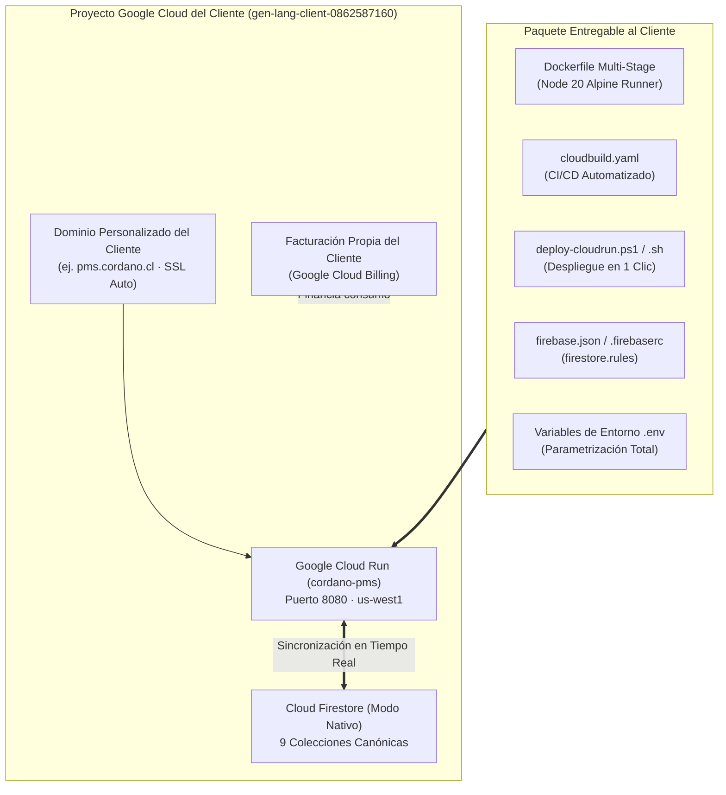

# CORDANO PMS — Guía Maestra de Paquetización, Despliegue en Cloud Run y Transferencia de Propiedad GCP

Esta guía documenta el procedimiento técnico para paquetizar, desplegar y **transferir la propiedad total del proyecto y de la infraestructura de Google Cloud al cliente final**, permitiéndote entregar el sistema como una solución *llave en mano* y desvincularte por completo del proyecto una vez finalizada la entrega.

---

## 1. Arquitectura Paquetizada y Autocontenida

El proyecto ha sido estructurado para que todas sus dependencias y servicios residan en un ecosistema Google Cloud 100% transferible:



### Componentes Clave Incluidos en el Paquete:
1. **[`Dockerfile`](file:///C:/Users/BraulioAM/OneDrive%20-%20UNIVERSIDAD%20ANDRES%20BELLO/PROYECTOS%20ANTIGRAVITY/CORDANO%20PMS%20FINAL/Dockerfile)**: Multi-stage build que genera una imagen ultraligera (~45 MB) conteniendo únicamente los binarios estáticos compilados y un servidor de producción seguro sin código fuente expuesto.
2. **[`cloudbuild.yaml`](file:///C:/Users/BraulioAM/OneDrive%20-%20UNIVERSIDAD%20ANDRES%20BELLO/PROYECTOS%20ANTIGRAVITY/CORDANO%20PMS%20FINAL/cloudbuild.yaml)**: Pipeline automatizado para que Cloud Build compile y despliegue el servicio automáticamente.
3. **[`deploy-cloudrun.ps1`](file:///C:/Users/BraulioAM/OneDrive%20-%20UNIVERSIDAD%20ANDRES%20BELLO/PROYECTOS%20ANTIGRAVITY/CORDANO%20PMS%20FINAL/deploy-cloudrun.ps1) y [`deploy-cloudrun.sh`](file:///C:/Users/BraulioAM/OneDrive%20-%20UNIVERSIDAD%20ANDRES%20BELLO/PROYECTOS%20ANTIGRAVITY/CORDANO%20PMS%20FINAL/deploy-cloudrun.sh)**: Scripts ejecutables con un solo clic para Windows y Linux/Cloud Shell que habilitan APIs, compilan el contenedor y despliegan en Cloud Run.
4. **[`firebase.json`](file:///C:/Users/BraulioAM/OneDrive%20-%20UNIVERSIDAD%20ANDRES%20BELLO/PROYECTOS%20ANTIGRAVITY/CORDANO%20PMS%20FINAL/firebase.json) y [`.firebaserc`](file:///C:/Users/BraulioAM/OneDrive%20-%20UNIVERSIDAD%20ANDRES%20BELLO/PROYECTOS%20ANTIGRAVITY/CORDANO%20PMS%20FINAL/.firebaserc)**: Enlazan las reglas de seguridad canónicas de Firestore ([`firestore.rules`](file:///C:/Users/BraulioAM/OneDrive%20-%20UNIVERSIDAD%20ANDRES%20BELLO/PROYECTOS%20ANTIGRAVITY/CORDANO%20PMS%20FINAL/firestore.rules)) al proyecto.
5. **[`src/services/firebase.ts`](file:///C:/Users/BraulioAM/OneDrive%20-%20UNIVERSIDAD%20ANDRES%20BELLO/PROYECTOS%20ANTIGRAVITY/CORDANO%20PMS%20FINAL/src/services/firebase.ts)**: Configuración parametrizada que lee variables de entorno de Vite con respaldo en [`firebase-applet-config.json`](file:///C:/Users/BraulioAM/OneDrive%20-%20UNIVERSIDAD%20ANDRES%20BELLO/PROYECTOS%20ANTIGRAVITY/CORDANO%20PMS%20FINAL/firebase-applet-config.json).

---

## 2. Procedimiento de Transferencia de Propiedad al Cliente (Handover)

Para desligarte por completo y dejar al cliente como único dueño legal y financiero de la infraestructura, se sigue el siguiente protocolo en **Google Cloud Console**:

### Opción A (Recomendada): Traspaso Directo del Proyecto Existente
Dado que el proyecto actual (`gen-lang-client-0862587160`) ya contiene Cloud Run y Firestore configurados, el traspaso es directo:

#### Paso 1: Asignar al Cliente como Propietario (`Owner`)
1. Ingresa a [Google Cloud Console](https://console.cloud.google.com/).
2. Asegúrate de tener seleccionado el proyecto `gen-lang-client-0862587160`.
3. En el menú de navegación izquierdo, ve a **IAM y administración > IAM** (*IAM & Admin > IAM*).
4. Haz clic en el botón superior **Otorgar acceso** (*Grant Access*).
5. En **Principales nuevos** (*New principals*), escribe el correo electrónico de Google o Google Workspace del cliente (ej. `admin@cordano.cl`).
6. En **Asignar roles** (*Assign roles*), selecciona **Básico > Propietario** (*Basic > Owner*).
7. Haz clic en **Guardar** (*Save*). Google enviará un correo de confirmación al cliente.

#### Paso 2: Traspaso de la Facturación (*Cloud Billing*)
Para que los costos de consumo (que en Cloud Run y Firestore para este volumen son típicamente gratuitos o menores a $5 USD/mes) se carguen al cliente:
1. Pídele al cliente que inicie sesión en GCP y vaya a **Facturación** (*Billing*).
2. El cliente debe vincular su tarjeta de crédito o cuenta bancaria creando una Cuenta de Facturación.
3. Ve a **IAM y administración > Facturación**, haz clic en **Cambiar cuenta de facturación** (*Change billing account*) y selecciona la cuenta de facturación del cliente.

#### Paso 3: Retiro de tu Cuenta de Desarrollador (Desvinculación Final)
1. Una vez que el cliente confirme que aceptó el rol de `Owner` y su facturación está activa:
2. Ve a **IAM y administración > IAM**.
3. Busca tu correo electrónico personal.
4. Haz clic en el ícono de lápiz o en **Eliminar principal** (*Remove principal*).
5. Guarda los cambios. A partir de este momento, **el cliente es el dueño absoluto y tú quedas completamente desligado del proyecto**.

---

### Opción B: Despliegue en un Proyecto de Google Cloud Creado por el Cliente
Si el cliente prefiere que el sistema viva en un proyecto nuevo creado desde cero bajo su propia organización:
1. Pídele al cliente que cree un proyecto en Google Cloud (ej. `cordano-pms-produccion`).
2. En la consola de Firebase ([console.firebase.google.com](https://console.firebase.google.com/)), el cliente añade Firebase a ese proyecto y crea la base de datos Firestore en modo nativo en la región `us-west1`.
3. Descarga el archivo de credenciales de la app web de Firebase y reemplaza los valores en `.env` o en `firebase-applet-config.json`.
4. Ejecuta el script de despliegue indicando el nuevo ID de proyecto:
   ```powershell
   # En Windows PowerShell:
   .\deploy-cloudrun.ps1 -ProjectId "cordano-pms-produccion"
   ```
   ```bash
   # En Cloud Shell o Linux:
   ./deploy-cloudrun.sh "cordano-pms-produccion"
   ```
5. Despliega las reglas de seguridad de Firestore:
   ```bash
   npx firebase deploy --only firestore:rules --project cordano-pms-produccion
   ```

---

## 3. Configuración del Dominio Personalizado del Cliente

Para que la garita y la administración accedan con la marca y dominio del cliente (por ejemplo, `https://pms.cordano.cl` o `https://estacionamiento.cordano.cl`), Cloud Run ofrece mapeo directo con certificado SSL gestionado gratuitamente por Google:

1. En la consola de Google Cloud, ve a **Cloud Run**.
2. Haz clic en el servicio `cordano-pms`.
3. En la barra superior, haz clic en **Administrar dominios personalizados** (*Manage custom domains*).
4. Haz clic en **Añadir asignación** (*Add mapping*):
   - Servicio a asignar: `cordano-pms`.
   - Especifica el dominio o subdominio: `pms.cordano.cl`.
5. Google Cloud te proporcionará los registros DNS requeridos:
   - Registro `CNAME`: Nombre `pms`, Valor `ghs.googlehosted.com.`.
   - O registros `A` / `AAAA` si se trata de un dominio raíz.
6. El cliente añade estos registros en su proveedor DNS (NIC Chile, Cloudflare, GoDaddy, etc.).
7. En unos minutos, Google emitirá automáticamente el certificado SSL (HTTPS) y el sistema quedará operativo en la URL del cliente.

---

## 4. Política de Respaldos de Largo Plazo (Soberanía de Datos)

Para garantizar la perdurabilidad histórica de la información sin requerir tu intervención:
1. **Respaldos Automáticos de Firestore**:
   - En Google Cloud Console, ir a **Cloud Scheduler**.
   - Crear un trabajo cron diario (ej. `0 3 * * *` a las 03:00 AM) que invoque la API de exportación de Firestore (`https://firestore.googleapis.com/v1/projects/{PROJECT_ID}/databases/(default):exportDocuments`) hacia un bucket de Cloud Storage (`gs://cordano-pms-backups`).
2. **Exportación a Google Sheets**:
   - Desde la pantalla de administración, el cliente puede pulsar "Vincular Google Sheets" para mantener un libro con las 11 pestañas sincronizadas en su propio Google Drive corporativo.
3. **Cortes Z Físicos y Digitales**:
   - Cada cierre de turno emite el Reporte Z en formato A4 con sellado criptográfico SHA-256 y espacio para dos firmas físicas (Operador y Supervisor), cumpliendo con el archivo contable y tributario.
