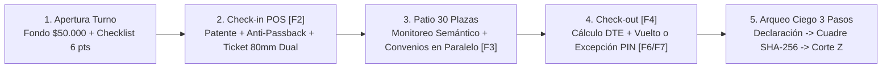

# Ejecución Integral: `/ux-audit` · `/magnific-ai` · `/idea-os`
**Proyecto:** ParkOps PMS & ERP — Cordano Inversiones Inmobiliarias Ltda. (Serrano 447, Iquique)

---

## 1. `/ux-audit` — Auditoría Heurística de Nielsen & Ergonomía de Garita

### Calificación Global: **A (96 / 100)**

| Heurística de Nielsen / Criterio UX | Estado | Implementación en la Interfaz Oficial |
| :--- | :--- | :--- |
| **1. Visibilidad del Estado del Sistema** | ✅ Aprobado | Indicador pulsante `GARITA 01 • SERRANO 447`, modo `OFFLINE (-O)` visible en navbar, cronómetro en vivo y notificaciones toast (`#toast-container`). |
| **2. Correspondencia con el Mundo Real** | ✅ Aprobado | Placas chilenas `.license-plate-chip`, formatos CLP tabulares (`$342.500`), terminología local de garita (*Sencillo*, *Arqueo Ciego*, *Corte Z*, *Boleta DTE*). |
| **3. Control y Libertad del Usuario** | ✅ Mejorado | Cierre rápido con `Esc` en todos los modales, retorno en Paso 2 del arqueo ciego y botón directo `Reimprimir [F8]` en liquidación de salida. |
| **4. Consistencia y Estándares** | ✅ Aprobado | Código semántico de plazas (`#10B981` Libre, `#64748B` Ocupado, `#3B82F6` Abonado, `#EF4444` Sobrestadía) y botones de acción primaria/destructiva consistentes. |
| **5. Prevención de Errores** | ✅ Mejorado | Validación **Anti-Passback en línea** al digitar una patente ya activa en el patio con enlace de recuperación `Ir a Cobro →`, y bloqueo de apertura de caja para rol `Administrador`. |
| **6. Reconocimiento antes que Recuerdo** | ✅ Mejorado | Etiquetas explícitas de atajos (`[F1]` a `[F9]`, `[Enter]`, `[Esc]`), visualización de daños previos en la ficha de salida y buscador predictivo de patentes/tickets. |
| **7. Flexibilidad y Eficiencia de Uso** | ✅ Aprobado | Autofoco automático en `#pos-entry-plate` y `#pos-exit-search-input`, botones rápidos de efectivo (`Exacto`, `$2k`, `$5k`, `$10k`, `$20k`) y clic directo desde el plano de patio a cobro. |
| **8. Diseño Estético y Minimalista** | ✅ Aprobado | Arquitectura Funcional Pura (`bg-slate-100`, tarjetas blancas limpias, cero ruido decorativo según directriz de `AGENTS.md`). |
| **9. Recuperación ante Errores** | ✅ Mejorado | Mensajes accionables cuando falta justificación (>10 caracteres) en descuentos por PIN o cuando ocurre colisión Anti-Passback. |
| **10. Ayuda y Documentación** | ✅ Aprobado | Módulo `#view-support` estilo Notion con buscador instantáneo de SOPs, protocolos de emergencia y *Showroom* interactivo de 3 etapas. |

### Mejoras UX Aplicadas Directamente en Código
1. **Prevención Anti-Passback en Vivo ([`src/app/page.tsx`](file:///c:/Users/BraulioAM/OneDrive%20-%20UNIVERSIDAD%20ANDRES%20BELLO/PROYECTOS%20ANTIGRAVITY/NUEVO%20PMS%20CORDANO/src/app/page.tsx#L814-L834))**: Al digitar una patente que ya está dentro de las 30 plazas, aparece una alerta preventiva ámbar con un botón de 1 clic (`Ir a Cobro →`) que carga el vehículo en la pestaña de salida sin perder tiempo.
2. **Inspección de Daños y Reimpresión Rápida ([`src/app/page.tsx`](file:///c:/Users/BraulioAM/OneDrive%20-%20UNIVERSIDAD%20ANDRES%20BELLO/PROYECTOS%20ANTIGRAVITY/NUEVO%20PMS%20CORDANO/src/app/page.tsx#L1142-L1171))**: Se incorporó la lectura visible de las observaciones de daños de ingreso durante el check-out y el botón `Reimprimir [F8]` con área táctil `>= 44px` (`h-11`).

---

## 2. `/magnific-ai` — Presets de Super-Resolución y Relighting para Slots Wireframe

Siguiendo la directriz de **Core Funcional Puro** ([`AGENTS.md`](file:///c:/Users/BraulioAM/OneDrive%20-%20UNIVERSIDAD%20ANDRES%20BELLO/PROYECTOS%20ANTIGRAVITY/NUEVO%20PMS%20CORDANO/AGENTS.md)), la interfaz mantiene sus `[ Slots Wireframe ]` limpios en `#view-landing`, mientras que en `#view-settings` ([`OfficialAuxViews.tsx`](file:///c:/Users/BraulioAM/OneDrive%20-%20UNIVERSIDAD%20ANDRES%20BELLO/PROYECTOS%20ANTIGRAVITY/NUEVO%20PMS%20CORDANO/src/components/official/OfficialAuxViews.tsx#L853-L893)) quedaron integrados los 3 Presets oficiales para exportación 4K/8K vía `POST https://api.freepik.com/v1/ai/image-upscaler`:

| Preset | Slot Destino en `#view-landing` | Engine | `Creativity` | `HDR` | `Resemblance` | `Fractality` |
| :--- | :--- | :--- | :---: | :---: | :---: | :---: |
| **Preset A: UI Dashboard** | Capturas POS Garita, Analítica y Arqueo Ciego | `magnific-precision` (*Faithful*) | `0` | `10` | `95` | `0` |
| **Preset B: Serrano 447** | Banner Principal / Vista Aérea 30 Plazas | `hard-surface` (*Architecture*) | `+3` | `45` | `75` | `35` |
| **Preset C: LPR & Hardware** | Cámaras CCTV LPR, Térmica 80mm y Gaveta RJ11 | `photographic` | `+2` | `30` | `80` | `20` |

---

## 3. `/idea-os` — Pipeline Estratégico de 5 Fases

### Fase 1 — Triage
> **Clasificación:** `T3 · S3` — *B2B Vertical PMS/ERP con cumplimiento fiscal SII DTE, control de hardware físico (impresora 80mm ESC/POS + gaveta RJ11), operación Offline-First y auditoría criptográfica `SHA-256` · Nivel Arquitecto de Sistemas / Senior PM.*

### Fase 2 — Clarify (Decisiones Operativas Consolidadas)
- **Quién y Dolor Crítico (*Who & Pain*)**: Operadores de garita en Serrano 447 expuestos a filas vehiculares en horario punta bancario/consular (12:00–15:30 hrs) y propietarios (Cordano Inversiones) vulnerables a fugas de efectivo por cobros manuales sin ticket o arqueos con monto esperado visible.
- **Alcance y Cuña (*Scope & Wedge*)**: Recinto físico de 30 plazas (`Sector A 01–15`, `Sector B 16–30`) + 5 sobrecupos (`SC-01..05`), cobro por minuto (`$25` Sedán, `$30` SUV, `$15` Moto) segregado de los servicios en paralelo (`Convenio $75.000/mes` y `Noche $8.000`).
- **Restricciones (*Constraints*)**: Prohibición de que el rol `Administrador` abra turnos de caja; obligatoriedad de PIN + justificación escrita (>10 caracteres) para descuentos y PIN de Admin para extravío de ticket (`+$8.000 CLP`).

### Fase 3 — Research (Insights No Obvios de Dominio)
1. **Asimetría de Información en Cierre de Turno**: Cuando el sistema muestra el "Efectivo Esperado" antes de que el cajero cuente la gaveta, los sobrantes nunca se declaran y los faltantes se maquillan. El **Arqueo Ciego de 3 pasos** elimina esta vulnerabilidad de raíz.
2. **Contaminación de Métricas `ALOS` y `Turnover`**: Mezclar abonados mensuales o pernoctas nocturnas (12+ horas) en la lista rotativa por minuto distorsiona la estadía media (`ALOS = 51 min`) y la rotación (`1.60x`). El submódulo paralelo en `#view-clients` bloquea la plaza física sin contaminar el flujo transitorio.
3. **Identificación Dual en Papel Térmico de 80mm**: Los lectores láser 1D económicos requieren `Code 128`, mientras que las cámaras o lectores ópticos 2D leen `QR` en `0.2s`. Imprimir ambos junto al correlativo `TKT-AAAAMMDD-T01-XXXX` garantiza lectura en el 100% de los casos.

### Fase 4 — PRD (Falsifiable Problem, Non-Goals & Metrics)
- **Declaración Falsable del Problema**: *Las operaciones de estacionamiento presencial sin arqueo ciego ni trazabilidad por PIN pierden entre un 8% y un 15% de su recaudación en efectivo por descuentos informales, tickets no emitidos y descuadres de turno.*
- **Non-Goals (Lo que explícitamente NO se construye)**:
  1. **No** permitir que un usuario con rol `Administrador` abra caja o cobre tickets directamente.
  2. **No** mostrar el saldo esperado en efectivo antes de que el operador confirme el Paso 1 del arqueo ciego.
  3. **No** mezclar pagos de convenios mensuales dentro de la liquidación por minuto del POS transitorio.
  4. **No** sobrecargar la interfaz operativa con fondos fotográficos pesados que degraden el contraste o la legibilidad tabular.
- **Métricas Leading & Lagging**:
  - *Leading*: Tiempo medio de Check-in `< 5 seg` (con autofoco `F2`), Tiempo de Check-out `< 8 seg`, 100% de descuentos con justificación `> 10 caracteres`.
  - *Lagging (North Star)*: `Discrepancia de Arqueo Ciego = $0 CLP` y `RevPAS >= $11.400 CLP / plaza / día`.

### Fase 5 — Plan de Ejecución & Kill Criteria

| Fase | Entregable Técnico | Métrica Objetivo | Kill Criterion (Criterio de Parada / Rollback) |
| :--- | :--- | :--- | :--- |
| **Fase 1: Core POS & Garita Local** | Interfaz oficial unificada (`src/app/page.tsx`), 3 subpestañas POS, Ticket 80mm Dual y Arqueo Ciego 3 pasos. | Check-in `< 5s` y 0 errores de compilación. | Si el operador requiere usar scroll vertical en 1080p o tarda `> 15s` en registrar un ingreso. |
| **Fase 2: Blindaje Antifraude & Cloud Run** | Sincronización con `/api/checkin`, `/api/checkout`, `/api/shifts`, `/api/audit`, sello `SHA-256` y sufijo offline `-O`. | 100% de excepciones auditadas con PIN (Verde/Rojo). | Si algún descuento o extravío de ticket puede procesarse sin PIN de 4 dígitos y motivo `> 10 chars`. |
| **Fase 3: Inteligencia RevPAS & ERP** | Dashboard `#view-map` (Franjas, Matriz Semanal, Comparativa y Plano 30 plazas) + Exportación CSV/Sheets. | `RevPAS >= $11.417` y `Turnover >= 1.6x`. | Si los registros de Convenios/Noche alteran el cálculo de `ALOS` de los vehículos transitorios. |
