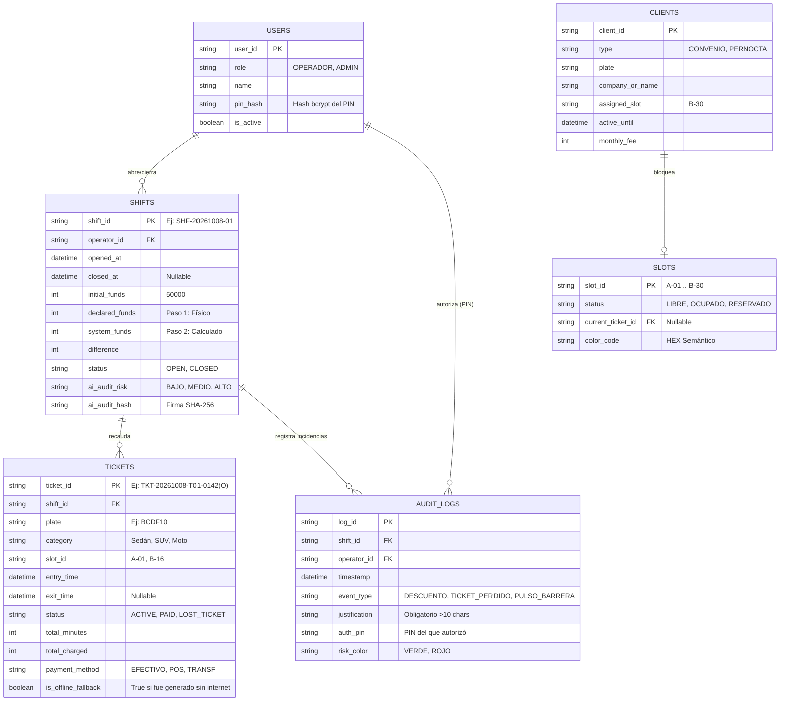

# Propuesta de Arquitectura de Base de Datos Cloud y Persistencia Offline-First

**Proyecto:** ParkOps PMS & ERP (Cordano Inversiones Inmobiliarias Ltda.)
**Entorno:** Google Cloud Platform (GCP) - `us-west1`
**Infraestructura:** Cloud Run + Firestore (Native Mode / Datastore) + Firebase Auth

De acuerdo a la documentación oficial y los lineamientos de la arquitectura (`DOCUMENTO_CENTRALIZADO_ESTRUCTURA_Y_DIRECTRICES_PARKOPS.md`), el sistema debe soportar una operación ininterrumpida en garita, registrando operaciones en modo offline (`IndexedDB -O`) y sincronizando con la nube (Cloud Run) al recuperar conectividad.

Para cumplir con este requisito y asegurar la persistencia, trazabilidad e inmutabilidad de los Reportes Z, propongo la siguiente arquitectura basada en **Google Cloud Firestore (NoSQL Document/Kind Store)**, la cual posee soporte nativo *Offline-First* a través de su SDK, ideal para arquitecturas SPA / PWA en terminales de garita.

---

## 1. Modelo Entidad-Relación (E-R) de Colecciones (Kinds)

---

## 2. Estrategia de Sincronización Offline-First (Cola `-O`)

Dado que el POS de garita debe operar en modo "Cero Latencia" (Keyboard-first F2 / F4):

1. **Lectura Inmediata (Hot Cache Local)**: Los estados de las plazas (Slots) y tickets activos se mantienen en el estado en memoria de React y se replican en la base de datos IndexedDB del navegador.
2. **Escritura en Contingencia**: Si falla el internet, la aplicación SPA crea el ticket con el sufijo `O` (Ej: `TKT-AAAAMMDD-T0X-XXXXO`). El registro se guarda en la tabla `pending_sync` de IndexedDB.
3. **Reconexión Automática**: Al recuperar conectividad (o al presionar "Reconectar a Cloud Run" en la vista `F5` Ajustes), un *Service Worker* (o hook de background) toma la cola `pending_sync` y la envía por lotes (Batch Write) a los endpoints nativos en `/api/checkin`, `/api/checkout` y `/api/audit`.
4. **Resolución de Conflictos**: El servidor en Cloud Run actúa como fuente de la verdad final, pero acepta los `timestamp` locales generados en el ticket offline para no alterar los tiempos de cobro al cliente.

---

## 3. Plan de Configuración en Google Cloud (GCP)

Para implementar esta arquitectura, se deben habilitar los siguientes servicios en el proyecto GCP (`gen-lang-client-0862587160`):

### Fase 1: Base de Datos y Autenticación
1. **Activar Firestore in Native Mode**: Ir a Google Cloud Console > Firestore > Crear Base de datos en `us-west1`.
   - *Por qué Native Mode*: Porque los SDKs cliente de Firebase/Firestore permiten suscripciones en tiempo real (`onSnapshot`) y sincronización automática Offline-first, eliminando la necesidad de programar manualmente IndexedDB para gran parte de la operación.
2. **Activar Firebase Auth**: Para manejar los inicios de sesión de los Operadores y Administradores de manera segura, utilizando JWT tokens.

### Fase 2: Despliegue en Cloud Run (Backend API)
1. **Actualizar el API Route de Next.js**: Modificar los archivos `src/app/api/*.ts` para que utilicen el **Admin SDK de Firebase (`firebase-admin`)** para leer y escribir en Firestore.
2. **Despliegue Contenerizado**:
   - Compilar el proyecto en imagen Docker (Next.js Standalone).
   - Enviar a Artifact Registry: `gcr.io/gen-lang-client-0862587160/cordano-pms-2026:latest`.
   - Desplegar en Cloud Run (`cordano-pms` en `us-west1`), asegurando asignación mínima de 1 vCPU y 512MiB. Configurar variables de entorno (`GOOGLE_APPLICATION_CREDENTIALS` o vincular la Service Account nativa de GCP).

### Fase 3: Reglas de Seguridad (Firestore Rules)
1. Solo la Service Account de Cloud Run (y usuarios autenticados con rol Admin) tendrán acceso de escritura irrestricta.
2. Los Operadores solo pueden escribir en las colecciones de su `shift_id` activo.
3. El campo `ai_audit_hash` y los `AUDIT_LOGS` de color ROJO serán inmutables (solo de adición `create`, bloqueando `update` y `delete`).

---

**¿Procedemos con la implementación técnica del Backend en los archivos del código?**
(Esto incluye instalar Firebase/Firestore, configurar la conexión en los endpoints y adaptar la UI para que escriba en las bases de datos de Google Cloud en vez de datos mockeados).
