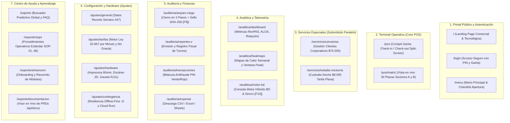

# Plan de Implementación: Nueva Arquitectura de Rutas (URLs) & Mapa de Sitio ParkOps ERP & POS

## 1. Visión General del Cambio

El usuario ha solicitado formalizar y aplicar un **Mapa de Sitio más intuitivo y estructurado por secciones y URLs**, organizando la plataforma en **7 secciones operativas y de gestión** con rutas limpias y descriptivas.

Este plan adapta dicho esquema a la arquitectura monolítica modular Next.js 16 / TypeScript / Offline-First del proyecto, asegurando que:
1. Las rutas funcionen tanto en el entorno servidor Next.js App Router como en la navegación cliente SPA (`window.history.pushState`).
2. Se preserve el soporte 100% autónomo y offline en el bundle único para Google AI Studio (`PARKOPS_FRONTEND_GOOGLE_AI_STUDIO.html`).
3. El `CollapsibleSidebar` (Dock ERP) y la paleta de comandos (`⌘K`) reflejen esta taxonomía jerárquica con iconos y atajos de teclado (`F1` a `F10`).
4. Se mantenga la regla estricta aprobada: **Cero dependencias de IA en el proceso operativo de garita (100% determinista y manual)**.

---

## 2. Mapa Canónico de Rutas (URLs) Recomendadas

Se consolidan **20 rutas canónicas agrupadas en 7 secciones funcionales**:

---

## 3. Matriz Detallada de Secciones, URLs y Componentes

| # | Sección | URL Canónica | Atajo | Componente Asociado | Responsabilidad Operativa |
| :-: | :--- | :--- | :-: | :--- | :--- |
| **1.1** | Portal & Auth | `/` | `Esc` | `OfficialLandingAndMenu.tsx` | Landing comercial con pliego Ley 20.967 y conmutador Wireframe / HD IA. |
| **1.2** | Portal & Auth | `/login` | --- | `OfficialLandingAndMenu.tsx` | Login RBAC (Operador vs Admin) con declaración de fondo ($50.000 CLP). |
| **1.3** | Portal & Auth | `/menu` | `F1` | `OfficialLandingAndMenu.tsx` | Dashboard de apertura, 4 KPIs y checklist de calidad de garita. |
| **2.1** | Terminal POS | `/pos` | `F2` / `F4` | `page.tsx` (`#view-pos`) | Split-screen sin scroll 1080p: Ingreso en <4s y Cobro con vuelto tabular. |
| **2.2** | Terminal POS | `/pos/matriz` | `Plano` | `OfficialAuxViews.tsx` | Grilla arquitectónica de 30 cupos (Sectores A y B) con código semántico. |
| **3.1** | Especiales | `/servicios/convenios` | `F3` | `OfficialAuxViews.tsx` | Registro mensual corporativo ($75.000). Bloquea plaza sin sumar a caja rotativa. |
| **3.2** | Especiales | `/servicios/estadia-nocturna` | --- | `OfficialAuxViews.tsx` | Custodia de noche ($8.000 tarifa plana, 21:00 a 08:00 hrs). |
| **4.1** | Analítica | `/analitica/dashboard` | --- | `OfficialAuxViews.tsx` | KPIs ejecutivos: RevPAS ($11.417), Rotación (1.60x), ALOS (51m). |
| **4.2** | Analítica | `/analitica/heatmaps` | --- | `OfficialAuxViews.tsx` | Mapa de calor semanal de ocupación horaria y detección de ventana peak. |
| **4.3** | Analítica | `/analitica/motor-bd` | `F10` | `OfficialEngineView.tsx` | Consola del motor híbrido (Hot Cache Redis `<5ms`, Datastore e IndexedDB). |
| **5.1** | Auditoría | `/auditoria/arqueo-ciego` | `F9` | `OfficialModals.tsx` | Cuadratura ciega en 3 pasos: conteo físico vs sistema + firma `SHA-256`. |
| **5.2** | Auditoría | `/auditoria/reportes-z` | --- | `OfficialAuxViews.tsx` | Generación y reimpresión de comprobante fiscal Corte Z del día. |
| **5.3** | Auditoría | `/auditoria/transacciones` | --- | `OfficialAuxViews.tsx` | Bitácora `/api/audit`: Verde (descuentos PIN Op) y Rojo (multas $8.000 PIN Admin). |
| **5.4** | Auditoría | `/auditoria/exportar` | --- | `/api/export/sheets` | Descarga de planilla dinámica CSV / Excel con codificación UTF-8 BOM. |
| **6.1** | Ajustes | `/ajustes/general` | --- | `OfficialAuxViews.tsx` | Ficha técnica Serrano 447, 700 m² y datos tributarios de Cordano Ltda. |
| **6.2** | Ajustes | `/ajustes/tarifas` | `F5` | `OfficialAuxViews.tsx` | Parámetros tarifarios por minuto (Sedán $25, SUV $30, Moto $15, 0m gracia). |
| **6.3** | Ajustes | `/ajustes/hardware` | --- | `OfficialLandingAndMenu.tsx` | Periféricos: bobina 80mm ESC/POS, escáner 2D, gaveta RJ11 pin 2, UPS. |
| **6.4** | Ajustes | `/ajustes/contingencia` | --- | `OfficialAuxViews.tsx` | Conmutador offline (`-O`), telemetría Cloud Run y cola de sincronización. |
| **7.1** | Soporte | `/soporte` | --- | `OfficialAuxViews.tsx` | Buscador predictivo global y preguntas frecuentes de garita. |
| **7.2** | Soporte | `/soporte/sops` | --- | `OfficialAuxViews.tsx` | Manuales de procedimientos estándar (SOP-01 al SOP-06). |
| **7.3** | Soporte | `/soporte/showroom` | --- | `OfficialAuxViews.tsx` | Onboarding interactivo y recorrido explicativo de los módulos. |
| **7.4** | Soporte | `/soporte/documentacion` | --- | `OfficialAuxViews.tsx` | Visor en vivo de PRDs y especificaciones técnicas oficiales (`/api/docs`). |

---

## 4. Cambios Propuestos en la Arquitectura de Código

### 4.1 Enrutador Cliente Isomórfico & Sincronización de URLs (`src/lib/routerSync.ts`)
- **[NEW] `src/lib/routerSync.ts`**:
  - Tabla de mapeo bidireccional entre la vista interna (`menu`, `pos`, `map`, `clients`, `reports`, `settings`, `support`, `engine`) y la URL canónica (`/pos`, `/pos/matriz`, `/servicios/convenios`, etc.).
  - Sincronizador con `window.history.pushState` y escucha de `popstate` para que el botón de volver/avanzar del navegador funcione de forma nativa sin recargar la página.
  - Soporte de sub-rutas directas (ej. `/pos?tab=exit` abre directamente la pantalla de cobro).

### 4.2 Actualización del Sidebar Lateral (`CollapsibleSidebar.tsx`)
- **[MODIFY] `src/components/navigation/CollapsibleSidebar.tsx`**:
  - Reorganizar los botones en **grupos visuales colapsables o segmentados**:
    - Grupo 1: Terminal Garita (`/pos`, `/pos/matriz`, `/menu`).
    - Grupo 2: Servicios Especiales (`/servicios/convenios`, `/servicios/estadia-nocturna`).
    - Grupo 3: Analítica & BD (`/analitica/dashboard`, `/analitica/motor-bd`).
    - Grupo 4: Auditoría & Finanzas (`/auditoria/transacciones`, `/auditoria/reportes-z`).
    - Grupo 5: Ajustes & Soporte (`/ajustes/tarifas`, `/soporte`).
  - Mostrar la URL de destino en el tooltip flotante para que el usuario conozca la ruta exacta.

### 4.3 Actualización de la Paleta de Comandos ⌘K (`CommandPaletteModal`)
- **[MODIFY] `src/components/official/PublishedLogicSuite.tsx`**:
  - Incorporar indexación de las 20 rutas canónicas para que al presionar `Ctrl+K` / `⌘K` el operador pueda escribir ej. *"convenios"*, *"reporte z"*, *"matriz"* o *"tarifas"* y saltar directamente a la ruta correspondiente.

### 4.4 Creación de Rutas Seguras en Next.js App Router (`src/app/`)
- **[NEW] Rutas Seguras en App Router**:
  - Crear páginas delegadas en App Router:
    - `src/app/pos/page.tsx`
    - `src/app/matriz/page.tsx`
    - `src/app/servicios/convenios/page.tsx`
    - `src/app/servicios/estadia-nocturna/page.tsx`
    - `src/app/analitica/dashboard/page.tsx`
    - `src/app/auditoria/reportes-z/page.tsx`
    - `src/app/auditoria/transacciones/page.tsx`
    - `src/app/ajustes/tarifas/page.tsx`
    - `src/app/soporte/page.tsx`
  - Cada una inicializa la aplicación en la vista correspondiente, permitiendo URLs directas y marcadores en el navegador.

### 4.5 Actualización de Documentación Canónica
- **[MODIFY] `docs/MAPA_DE_SITIO_Y_ARQUITECTURA.md`**: Actualizar la especificación con la nueva tabla de 7 secciones y 20 URLs.
- **[MODIFY] `docs/DOCUMENTO_CENTRALIZADO_ESTRUCTURA_Y_DIRECTRICES_PARKOPS.md`**: Sincronizar el catálogo de rutas canónicas en el documento maestro.

### 4.6 Sincronización del Bundle Google AI Studio
- **[MODIFY] `PARKOPS_FRONTEND_GOOGLE_AI_STUDIO.html`** & `scratch/build_aistudio_html.js`:
  - Asegurar que el router cliente mapee las URLs internamente con compatibilidad de hash (`#/pos`, `#/servicios/convenios`, etc.) para ejecución en iframe aislado de AI Studio.

---

## 5. Plan de Verificación

### 5.1 Pruebas Automatizadas
- `npx.cmd tsc --noEmit`: Validación estricta de TypeScript (0 errores).
- Verificación del generador de HTML `scratch/build_aistudio_html.js`.

### 5.2 Pruebas Manuales
1. Navegar por el Sidebar y verificar que la barra de direcciones del navegador actualice limpiamente a `/pos`, `/servicios/convenios`, `/auditoria/transacciones`, etc.
2. Probar la navegación con botón Atrás y Adelante del navegador.
3. Abrir la paleta `Ctrl+K` / `⌘K`, teclear una ruta (ej. `convenios`) y confirmar salto inmediato.
4. Validar que la operación de garita POS se mantenga sin scroll a 1080p y 100% determinista sin dependencias de IA.
