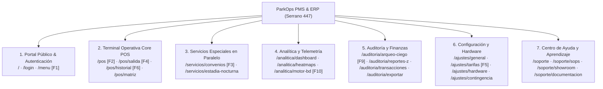
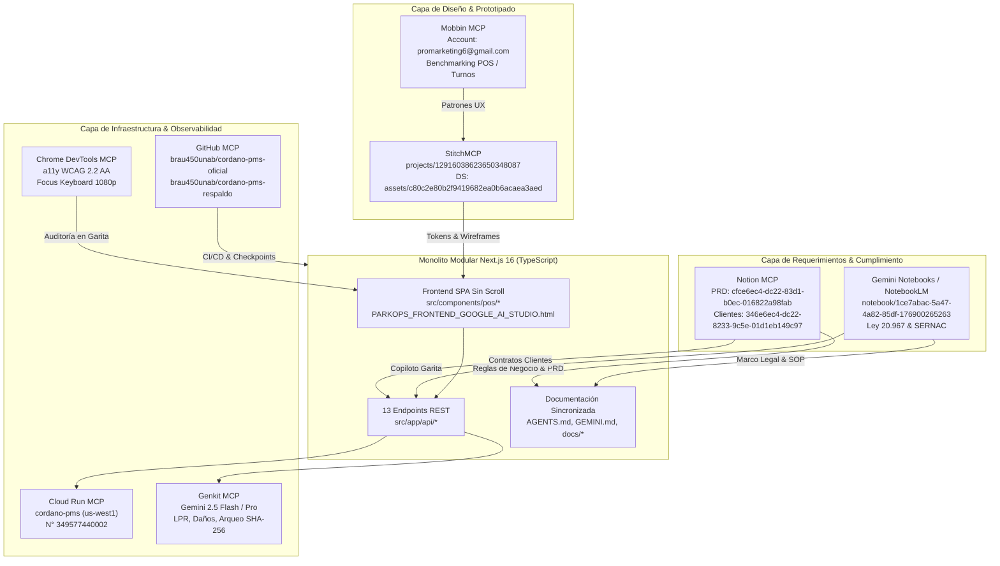

# Documento Centralizado: Estructura de la Plataforma, Arquitectura de Información & Directrices Claves del Sistema

**ParkOps PMS & ERP — Versión 4.5.0 Enterprise**  
**Cliente / Operación**: Cordano Inversiones Inmobiliarias Ltda.  
**Instalación Física**: Calle Serrano 447, Iquique, Región de Tarapacá, Chile (~700 m²)  
**Fecha de Emisión**: Octubre 2026 | **Estado**: Oficial y Centralizado  

---

## 1. Identidad del Sistema, Alcance y Contexto Físico/Cloud

### 1.1 Propósito General
**ParkOps PMS & ERP** es la plataforma integral de gestión de estacionamientos, recaudación presencial en garita, auditoría antifraude y control financiero desarrollada para la operación de Cordano Inversiones Inmobiliarias Ltda. en Serrano 447, Iquique.

El sistema resuelve la vulnerabilidad operativa tradicional de los estacionamientos urbanos: elimina las fugas de caja en los cambios de turno, acelera el flujo vehicular en horas punta comerciales, aísla contablemente los clientes mensuales de la rotación por minuto y garantiza operatividad 100% continua ante cortes de internet.

### 1.2 Parámetros Físicos del Recinto (Serrano 447)
- **Superficie**: ~700 m² pavimentados y señalizados en asfalto de alta resistencia.
- **Capacidad Total**: **30 Plazas Físicas Demarcadas** + **5 Plazas de Sobrecupo**:
  - **Sector A (Plazas 01 a 15)**: Cupos `A-01` a `A-15`, ubicados en la calzada izquierda y acceso preferencial.
    - `A-01` y `A-02`: Plazas Reservadas para Movilidad Reducida (**PMR**, Cian `#06B6D4`).
    - `A-03`: Punto de Electromovilidad (**EV**, Violeta `#8B5CF6`).
  - **Sector B (Plazas 16 a 30)**: Cupos `B-16` a `B-30`, ubicados en la zona posterior y convenios corporativos.
    - `B-29` y `B-30`: Plazas bloqueadas para convenios mensuales fijos (Azul `#3B82F6`).
  - **Sobrecupo Operativo**: Plazas `SC-01` a `SC-05` activadas por el operador en sobredemanda de patio.

### 1.3 Infraestructura Tecnológica & Ecosistema Cloud
- **Proyecto GCP**: `gen-lang-client-0862587160` (N° Proyecto `349577440002`) | Región: `us-west1` (Oregon).
- **Contenedor Cloud Run**: Microservicio `cordano-pms` en puerto `8080` (Fully Managed Gen2 Linux x86_64, escalado 0 a 10 instancias, asignación 512 MiB / 1 vCPU).
- **Dominio / URLs**: `https://cordano-pms-349577440002.us-west1.run.app` / `https://cordanopms.ai.studio`.
- **Google Stitch Project (Oficial Activo)**: `projects/12916038623650348087` (*NUEVO PMS CORDANO - ParkOps Iquique* - `https://stitch.withgoogle.com/projects/12916038623650348087`).
  - **Design System Asset**: `assets/c80c2e80b2f9419682ea0b6acaea3aed` (basado en `DESIGN.md`).
  - **Pantallas Oficiales Generadas**:
    1. POS Check-in & Vehículos en Turno (`d09c4b80583e4978a4cb2630441bd485`)
    2. Plano 2D Arquitectónico Bloques A y C (`83e3e5b92d9645ed920a1a94c21c5e7a`)
    3. Proceso de Salida & Calculadora de Vuelto (`16aa7c649bbc45eaab47c4bcb7879ae6`)
    4. Cierre de Caja Ciego en 3 Columnas & SHA-256 (`3b4892334a8744148bc67cbd67e7f9cf`)
  - **Proyectos de Referencia Histórica**: `projects/11170226797373845541` (diseño previo de referencia) y `projects/10292600008632163693` (prototipo inicial).
- **Notion Workspace & MCP (`@notionhq/notion-mcp-server`)**:
  - PRD Canónico: ID `cfce6ec4-dc22-83d1-b0ec-016822a98fab` (`docs/PRD_SISTEMA_DE_PARKING.md`).
  - Plan de Arquitectura: ID `3c9e6ec4-dc22-81d6-846a-ce92fa83b159` (`docs/PLAN_DE_ARQUITECTURA.md`).
  - Base de Datos de Clientes & Contabilidades Cordano: ID `346e6ec4-dc22-8233-9c5e-01d1eb149c97`.
- **Gemini Notebooks / NotebookLM MCP (`@m4ykeldev/notebooklm-mcp`)**:
  - Notebook Oficial: `https://notebook.google.com/notebook/1ce7abac-5a47-4a82-85df-176900265263` (Marco normativo Ley N° 20.967, manual de procedimientos y fiscalización SERNAC/SII).
- **Repositorios GitHub**:
  - Oficial de Producción: `brau450unab/cordano-pms-oficial` (sincronizado con Antigravity, AI Studio, Stitch y Cloud Run).
  - Respaldo y Puntos de Restauración: `brau450unab/cordano-pms-respaldo`.
- **Persistencia Híbrida**: Monolito Modular Next.js 16 (React 19, Tailwind CSS v4) con persistencia *Offline-First* en el navegador (`IndexedDB` local) y sincronización REST con el almacén en memoria / Cloud Run.

---

## 2. Arquitectura de Rutas Canónicas y Mapa Integral de la Plataforma

La plataforma opera bajo una arquitectura de **Single-Page Operational App (SPA) Isomórfica** con soporte dual: Next.js 16 App Router (con delegación de rutas directas para bookmarks y refrescos) y HTML estático para Google AI Studio (`PARKOPS_FRONTEND_GOOGLE_AI_STUDIO.html`) mediante sincronización reactiva en `src/lib/routerSync.ts` (`history.pushState` / `popstate`).

### 2.1 Las 7 Secciones Funcionales y 20 Rutas Canónicas (URLs)



| Sección | Ruta Canónica | Vista / Subtab | Atajo | Función Operativa |
| :--- | :--- | :--- | :--- | :--- |
| **1. Portal & Auth** | `/` | `landing` | `Esc` | Portal Comercial Ley 20.967 y conmutador visual Wireframe / 8K |
| | `/login` | `landing` (login) | — | Control RBAC (Operador vs Admin) y fondo inicial |
| | `/menu` | `menu` | `F1` | Menú principal de garita, 4 KPIs vivos y checklist de 6 puntos |
| **2. Terminal POS** | `/pos` | `pos` (`entry`) | `F2` | Cockpit de garita: registro vehicular en <4s, autofoco inmediato y 0m gracia |
| | `/pos/salida` | `pos` (`exit`) | `F4` | Liquidación y cobro: búsqueda por patente/ticket, cálculo y vuelto en CLP |
| | `/pos/historial` | `pos` (`history`) | `F6` | Listado correlativo de tickets emitidos y cobrados en la jornada |
| | `/pos/matriz` | `map` (`matrix`) | `Plano` | Matriz 2D arquitectónica de 30 plazas (Sectores A y B, 7 colores semánticos) |
| **3. Servicios Esp.** | `/servicios/convenios` | `clients` | `F3` | Convenios corporativos mensuales ($75.000 CLP/mes, bloquea plaza sin alterar rotativo) |
| | `/servicios/estadia-nocturna`| `clients` | — | Custodia pernocta ($8.000 CLP tarifa plana, franja 21:00 a 08:00 hrs) |
| **4. Analítica** | `/analitica/dashboard` | `map` (`hourly`) | — | Métricas clave: RevPAS ($11.417), ALOS (51m), rotación (1.60x) |
| | `/analitica/heatmaps` | `map` (`heatmap`) | — | Matriz de ocupación horaria y detección de ventana peak (12:00 a 15:30 hrs) |
| | `/analitica/motor-bd` | `engine` | `F10` | Consola técnica: Redis Hot Cache <5ms, Datastore Kinds y cola IndexedDB -O |
| **5. Auditoría** | `/auditoria/arqueo-ciego`| `reports` | `F9` | Arqueo ciego en 3 pasos con conteo físico y firma criptográfica SHA-256 |
| | `/auditoria/reportes-z` | `reports` | — | Emisión e impresión térmica en 80mm de cortes Z tributarios |
| | `/auditoria/transacciones`| `reports` | — | Bitácora inmutable PIN: Verde (descuentos) y Rojo (multas ticket perdido) |
| | `/auditoria/exportar` | `reports` | — | Descarga dinámica de planilla contable CSV UTF-8 BOM (/api/export/sheets) |
| **6. Ajustes** | `/ajustes/general` | `settings` | — | Ficha técnica del recinto Serrano 447 (700 m², 30 plazas + 5 sobrecupos) |
| | `/ajustes/tarifas` | `settings` | `F5` | Tarifario oficial por minuto (Sedán $25, SUV $30, Moto $15, extravío $8.000) |
| | `/ajustes/hardware` | `settings` | — | Homologación impresora 80mm ESC/POS, escáner 2D, gaveta RJ11 y barrera |
| | `/ajustes/contingencia` | `settings` | — | Conmutador offline-first (-O), latencia GCP y cola de sincronización |
| **7. Soporte** | `/soporte` | `support` | — | Buscador predictivo global de procedimientos y asistencia |
| | `/soporte/sops` | `support` | — | Manuales operativos canónicos SOP-01 a SOP-06 para garita |
| | `/soporte/showroom` | `support` | — | Showroom interactivo guiado de módulos operacionales |
| | `/soporte/documentacion`| `support` | — | Visor en vivo de PRDs y contratos de arquitectura (/api/docs) |

---

## 3. Catálogo de los 14 Endpoints Backend Conectados

El frontend interactúa con 14 endpoints REST nativos (`src/app/api/*`) que operan tanto en modo servidor (Next.js / Cloud Run) como con tolerancia autónoma a fallos en el bundle de Google AI Studio:

| # | Endpoint | Verbo | Componente Frontend | Descripción y Contrato de Datos |
| :---: | :--- | :---: | :--- | :--- |
| **1** | `/api/slots` | `GET` | `#view-pos`, `#view-map` | Retorna el estado en tiempo real de las 30 plazas + 5 sobrecupo (`A-01..A-15`, `B-16..B-30`), estado ocupado/libre/reservado, patentes asignadas y modo offline. |
| **2** | `/api/checkin` | `POST` | `#pos-subtab-entry` | Registra el ingreso vehicular. Valida formato de patente chilena/Mercosur, previene reingreso duplicado (*Anti-Passback*), asigna plaza y emite correlativo de ticket `TKT-AAAAMMDD-T0X-XXXX` (o sufijo `O`). |
| **3** | `/api/checkout` | `POST` | `#pos-subtab-exit` | Realiza la liquidación de salida. Calcula la estadía exacta a **0 minutos de gracia**, aplica descuentos autorizados o recargo por extravío, registra el método de pago y libera la plaza en la matriz. |
| **4** | `/api/shifts` | `GET/POST` | `#view-landing`, `#modal-close-shift` | Control del ciclo de vida del turno de caja. Acción `OPEN`: apertura con fondo inicial obligatorio (`$50.000 CLP`). Acción `CLOSE`: cierre ciego con efectivo declarado vs sistema, diferencia y sello `SHA-256`. |
| **5** | `/api/audit` | `GET/POST` | `#view-reports`, `#modal-pin-auth` | Bitácora inmutable de eventos antifraude. Registra tipo de evento, usuario, sello de tiempo, justificación escrita y clasificación por color (`VERDE`, `ROJO`, `AZUL`, `GRIS`). |
| **6** | `/api/ai/lpr-ocr` | `POST` | `#pos-subtab-entry` (`[LPR IA]`) | Invocado al presionar el botón `[LPR IA]`. Emplea Gemini 2.5 Flash Vision para analizar la captura de cámara, extrayendo patente (ej. `BCDF10`), categoría vehicular y porcentaje de confianza (`99.4%`). |
| **7** | `/api/ai/damage-inspection` | `POST` | `#pos-subtab-entry` (`[Peritaje IA]`) | Invocado al presionar el botón `[Peritaje IA]`. Analiza la carrocería en acceso y redacta un acta preventiva de daños preexistentes en el campo de observaciones (SOP-03). |
| **8** | `/api/ai/shift-audit` | `POST` | `#modal-close-shift` (Paso 2) | Auditor Financiero IA. Evalúa las desviaciones entre efectivo físico declarado y efectivo esperado del sistema, emitiendo un dictamen financiero con nivel de riesgo (`BAJO`, `MEDIO`, `ALTO`) y recomendaciones de control interno. |
| **9** | `/api/ai/assistant` | `POST` | `#view-support` | Copiloto Operativo de Garita. Responde dudas en lenguaje natural del operador respecto a tarifas, normativas legales, resolución de incidencias y SOPs de Serrano 447. |
| **10** | `/api/ai/tools` | `POST` | `#view-support` | Motor de *Function Calling* operativo. Ejecuta funciones backend directamente (`getParkingStatus` para consultar plazas, `calculateParkingFee` para cotizar estadía y `triggerBarrierPulse` para accionar la barrera). |
| **11** | `/api/cloudrun` | `GET/POST` | `#view-settings` | Expone metadatos de arquitectura, revisión activa (`cordano-pms-v1-00045-iqk`), memoria asignada y permite enviar pruebas de latencia RTT al microservicio en Google Cloud Run. |
| **12** | `/api/health` | `GET` | TopBar, `#view-landing`, `#view-settings` | Healthcheck y telemetría operativa en vivo. Retorna disponibilidad de servicio, recuento de plazas ocupadas/disponibles, memoria RSS en MB y tiempo de actividad (`uptimeSeconds`). |
| **13** | `/api/docs` & `/api/export/sheets` | `GET` | `#view-support`, `#view-reports` | `/api/docs` entrega el contenido Markdown en vivo de los PRDs canónicos de `docs/`. `/api/export/sheets` genera y descarga la planilla CSV dinámica con codificación UTF-8 BOM para Excel / Sheets. |
| **14** | `/api/auth/totp` | `GET/POST` | `#modal-pin-auth`, `/admin/usuarios` | Motor de visación y doble factor TOTP (RFC 6238). Genera secretos Base32, códigos QR para Google Authenticator, valida tokens de 6 dígitos en tiempo real y registra la autorización del administrador en la bitácora inmutable. |

---

## 4. Las 7 Reglas de Dominio Inviolables del Sistema

Todo desarrollo, ajuste visual o actualización de código debe respetar estrictamente estas directrices permanentes:

### Regla 1: Ergonomía de Garita Keyboard-First y Sin Scroll Vertical
- El operador de garita trabaja con teclado de acceso directo:
  - `F1`: Menú Principal.
  - `F2`: Ingreso Vehicular (POS) con autofoco inmediato en el campo de patente.
  - `F3`: Submódulo en Paralelo (Abonados & Noche).
  - `F4`: Liquidación de Salida (POS) con autofoco en búsqueda de ticket/patente.
  - `F5`: Configuración y Contingencia Offline.
  - `F6`: Historial de Tickets del Turno.
  - `F8`: Pulso manual de barrera con registro en auditoría.
  - `F9`: Cierre de Caja Ciega.
  - `Enter`: Confirmar acción primaria.
  - `Esc`: Cancelar o cerrar cualquier modal emergente.
- En pantallas estándar de garita (1080p y 4K), el flujo operativo principal del POS (`#view-pos`) opera **sin scroll vertical ni horizontal**.

### Regla 2: Tipografía Numérica Tabular Inmutable
- Todo valor monetario en Pesos Chilenos (`$4.500 CLP`), temporizador de permanencia (`01:42:15`), porcentaje de ocupación o patente vehicular DEBE utilizar la clase `tabular-nums` y tipografía monoespaciada fija (`font-mono` / `JetBrains Mono`) para prevenir saltos de línea y micro-parpadeos durante actualizaciones en tiempo real.
- Toda patente vehicular se presenta encerrada en la clase de diseño `.license-plate-chip`.

### Regla 3: Código Semántico Oficial de Colores para las Plazas
La matriz física de Serrano 447 utiliza un código cromático estandarizado:
- **Disponible (Libre)**: Verde Esmeralda (`#10B981`)
- **Ocupada (Vehículo en patio)**: Gris Pizarra (`#64748B`)
- **Reservada (Bloqueo temporal)**: Ámbar (`#F59E0B`)
- **Abonado / VIP / Convenio Mensual**: Azul (`#3B82F6`)
- **PMR (Movilidad Reducida - Plazas A-01 y A-02)**: Cian (`#06B6D4`)
- **Punto de Carga EV (Electromovilidad - Plaza A-03)**: Violeta (`#8B5CF6`)
- **Sobrestadía / Alerta (Estadía >= 120 min o incidencia)**: Rojo (`#EF4444`)

### Regla 4: Identificación de Tickets Térmicos y Resiliencia Offline
- **Formato Online**: `TKT-AAAAMMDD-T0X-XXXX` (ej. `TKT-20261008-T01-0142`).
- **Formato Contingencia Offline**: Añade el sufijo **`O`** (`TKT-AAAAMMDD-T0X-XXXXO`).
- **Ticket Térmico (80mm)**: Salida en papel con guillotina automática incorporando **Código QR** (para lectura rápida con cámara o escáner 2D) y **Código lineal (Code 128)** con correlativo alfanumérico legible para lectores láser tradicionales o digitación de contingencia.
- **Leyenda Legal Obligatoria**: Todo comprobante emitido incluye la advertencia legal del recargo reglamentario por pérdida de ticket de **`$8.000 CLP`**.

### Regla 5: Auditoría Antifraude, Aprobación Remota TOTP y Arqueo de Caja Ciega
- **Apertura**: Declaración obligatoria de fondo inicial de sencillo para dar vuelto (`$50.000 CLP`).
- **Aprobación de Excepciones Críticas (Google Authenticator TOTP RFC 6238)**:
  - Todo descuento comercial, rebaja de tarifa, recargo por ticket extraviado (`$8.000 CLP`), anulación o fuga exige **código temporal de 6 dígitos** generado por la app Google Authenticator del Administrador o Supervisor asignado.
  - El operador de garita selecciona al administrador autorizador de la lista, ingresa el token temporal de 6 dígitos (con tolerancia de ±30 seg) y digita una justificación escrita obligatoria superior a 10 caracteres.
  - Para situaciones de urgencia extrema con garita colapsada y administrador incomunicado, se dispone de la opción *Liberar y Dejar Pendiente* (justificación estricta >30 caracteres), la cual bloquea el arqueo de caja hasta su visación administrativa definitiva.
  - Resaltado inmutable en auditoría: **Verde** para descuentos/rebajas visadas, **Rojo** para pérdidas de ticket o anulaciones, y **Ámbar** para visaciones diferidas.
- **Arqueo Ciego en 3 Pasos**:
  - *Paso 1*: El operador declara físicamente el efectivo contado en su gaveta (ingreso numérico directo, sin calculadora de denominaciones en este paso para evitar dispersión operativa).
  - *Paso 2*: El sistema revela el efectivo esperado según tickets liquidados, calcula la diferencia (`Efectivo Sistema` vs `Efectivo Físico`), muestra el **Dictamen del Auditor Financiero IA** (`/api/ai/shift-audit`) y genera la firma criptográfica sellada con hash `SHA-256`.
  - *Paso 3*: Confirmación y emisión del Corte Z fiscal definitivo.

### Regla 6: Estructura Estética Minimalista & Conmutador Visual
- La interfaz se basa en el lenguaje visual de **Linear App y Vercel Dashboard** (superficies en `#ffffff`, bordes `#e8ecf0`, fondo `#f4f6f9`, acentos monocromáticos y esmeralda).
- En la Landing Page (`#view-landing`), se implementó un conmutador interactivo:
  - **Modo Render HD IA**: Despliega las fotografías arquitectónicas y de producto generadas en 8K (`serrano-447-hero.jpg`, `hardware-garita-kit.jpg`, `lpr-cctv-vision.jpg`).
  - **Modo Wireframe Estructural**: Restaura los bloques delimitados con bordes punteados `[ Slot Wireframe ]` para auditorías estructurales y pruebas de concepto limpias.

### Regla 7: Segregación Estricta de Roles (RBAC) y Servicios en Paralelo
- **Incompatibilidad de Caja para Administradores**: El rol de Administrador audita, supervisa y configura tarifas, pero **no puede abrir turnos de caja directamente**. Debe utilizar una cuenta de Operador de Garita para salvaguardar la trazabilidad de arqueo y evitar conflictos de interés.
- **Servicios Paralelos (Convenios y Noche)**: Los vehículos con convenio mensual (`$75.000 CLP/mes`) o pernocta nocturna (`$8.000 CLP`) se gestionan en el submódulo paralelo (`#view-clients` / `[F3]`). Bloquean su plaza física en la matriz de 30 cupos, pero **no ingresan a la nómina de transitorios ni alteran la contabilidad por minuto del día**.

---

## 5. Tarifario Oficial Unificado y Cumplimiento SERNAC (Ley N° 20.967)

| Categoría / Servicio | Tarifa Oficial (CLP) | Modalidad de Cobro | Regla de Cobro & Base Mínima |
| :--- | :---: | :---: | :--- |
| **Automóvil / Sedán** | **`$25 CLP`** | Por minuto efectivo | **0 min de gracia**. Cobro base de 30 min (`$750 CLP`). |
| **Camioneta / SUV** | **`$30 CLP`** | Por minuto efectivo | **0 min de gracia**. Cobro base de 30 min (`$900 CLP`). |
| **Motocicleta** | **`$15 CLP`** | Por minuto efectivo | **0 min de gracia**. Cobro base de 30 min (`$450 CLP`). |
| **Convenio Corporativo Mensual** | **`$75.000 CLP`** | Mensual anticipado | Submódulo paralelo `[F3]`. Plaza fija reservada en matriz. |
| **Pernocta Noche** | **`$8.000 CLP`** | Por noche | Submódulo paralelo `[F3]`. Franja 21:00 a 08:00 hrs. |
| **Recargo Ticket Extraviado** | **`$8.000 CLP`** | Cargo único por evento | Exige PIN Administrador (`9999`) y revisión de padrón vehicular. |
| **Fondo Inicial de Sencillo** | **`$50.000 CLP`** | Fondo gaveta garita | Declaración obligatoria de apertura para vuelto en efectivo. |

---

## 6. Procedimientos Operativos Estándar (SOP) Claves

### 6.1 SOP-01: Apertura de Turno en Garita (Fase 1)
1. El operador ingresa a `#view-landing`, selecciona el rol **Operador de Garita**, digita su usuario/clave y declara el fondo de sencillo obligatorio de **`$50.000 CLP`**.
2. Al iniciar sesión, el sistema redirige al Menú Principal (`#view-menu`).
3. El operador revisa los 6 puntos del **Checklist de Calidad** (perímetro Serrano 447, cámaras CCTV, extintor y alumbrado, limpieza, conciliación física de 30 plazas y papel térmico 80mm).
4. Pulsa **`Firmar Apertura`** para habilitar el POS y dejar registro en `/api/audit`.

### 6.2 SOP-02: Ingreso Vehicular en Menos de 4 Segundos (Fase 2 - `[F2]`)
1. El vehículo se posiciona frente a la barrera en Serrano 447.
2. El operador pulsa **`F2`**; el cursor se enfoca automáticamente en el campo de patente.
3. *Opción Rápida con IA*: El operador hace clic en **`[LPR IA]`**; Gemini Vision captura la matrícula y categoría automáticamente. Si existen rasguños o abolladuras visibles, presiona **`[Peritaje IA]`** para que se describan en las observaciones.
4. *Opción Manual*: El operador tipea la patente (ej. `BCDF10`), selecciona categoría vehicular y presiona **`Enter`**.
5. Se dispara `POST /api/checkin`: la barrera abre (o se pulsa `F8`), se imprime el ticket térmico de 80mm con código dual QR/Code 128 y la plaza seleccionada cambia a Gris Pizarra (`#64748B`).

### 6.3 SOP-03: Liquidación de Salida y Cobro (Fase 4 - `[F4]`)
1. El cliente presenta el ticket en la ventanilla de garita.
2. El operador pulsa **`F4`** y escanea el código QR o de barras (o selecciona el auto en la lista de patio).
3. El sistema calcula la tarifa exacta con **0 minutos de gracia** (tiempo transcurrido por tarifa por minuto).
4. El operador selecciona el medio de pago:
   - **Efectivo**: Ingresa el monto recibido; el sistema calcula el vuelto exacto con tipografía tabular y pulsa el pin 2 RJ11 para abrir la gaveta.
   - **Tarjeta Transbank POS**: Cobra en el terminal físico e ingresa confirmación.
   - **Transferencia**: Verifica acreditación bancaria.
5. Se pulsa **`Enter`**: se registra en `/api/checkout`, la plaza vuelve a Verde Esmeralda (`#10B981`) y se autoriza la salida.

### 6.4 SOP-04: Gestión de Ticket Extraviado (PIN Administrador)
1. Si el cliente extravió su ticket, el operador selecciona la opción de ticket perdido en `#pos-subtab-exit`.
2. Se solicita cédula de identidad y padrón del vehículo para acreditar dominio.
3. Se abre `#modal-pin-auth` en contexto **Rojo** (`LOST_TICKET`).
4. El Administrador ingresa su PIN (`9999`) y se aplica el recargo de **`$8.000 CLP`**, quedando asentado en `/api/audit`.

### 6.5 SOP-05: Contingencia ante Caída de Internet (Modo Offline `-O`)
1. Si se interrumpe la conexión a internet, el sistema activa automáticamente (o mediante el interruptor en `F5`) el modo contingencia offline.
2. La barra superior muestra la alerta ámbar **`MODO OFFLINE (CONTINGENCIA -O)`**.
3. Todo ticket emitido añade el sufijo **`O`** (`TKT-20261008-T01-0142O`) y se almacena en `IndexedDB` local.
4. Al restablecerse el enlace, el operador pulsa **`Reconectar a Cloud Run`** en `F5` para sincronizar la cola de transacciones con el servidor central sin pérdida de datos.

### 6.6 SOP-06: Cierre de Turno y Arqueo de Caja Ciega (Fase 6 - `[F9]`)
1. Al término de la jornada, el operador pulsa **`F9`** para abrir `#modal-close-shift`.
2. **Paso 1**: Cuenta el dinero físico de la gaveta y digita directamente el monto total de efectivo contado (sin conocer previamente la cifra calculada por el sistema).
3. **Paso 2**: El sistema coteja el efectivo físico contra el efectivo registrado en sistema. Se despliega el **Dictamen del Auditor Financiero IA** (`/api/ai/shift-audit`) con semáforo de riesgo (`BAJO`, `MEDIO`, `ALTO`), diagnóstico de discrepancias y el sello criptográfico `SHA-256`.
4. **Paso 3**: Se confirma el cuadre, se imprime el comprobante de fin de turno y se emite el **Corte Z Fiscal**, liberando la garita para el siguiente relevo.

---

## 7. Instrucciones para la Ejecución y Despliegue en Google AI Studio

Para importar y poner en marcha la plataforma en **Google AI Studio (Gemini 2.5 Pro / Flash)**:

1. **Archivo Autocontenido**: Utilizar el archivo **[`PARKOPS_FRONTEND_GOOGLE_AI_STUDIO.html`](file:///c:/Users/BraulioAM/OneDrive%20-%20UNIVERSIDAD%20ANDRES%20BELLO/PROYECTOS%20ANTIGRAVITY/NUEVO%20PMS%20CORDANO/PARKOPS_FRONTEND_GOOGLE_AI_STUDIO.html)** (`249 KB`), el cual incluye React 18, Babel Standalone, Tailwind CSS CDN, fuentes de Google, datos semilla y los 4 módulos unificados en un solo documento.
2. **Previsualización de Renders**: El archivo cuenta con resolución relativa automática (`./public/assets/parkops/*`) y fallback automático a diagramas vectoriales SVG embebidos si se ejecuta dentro de un iframe aislado de AI Studio sin acceso al sistema de archivos local.
3. **Prompt del Sistema Recomendado**:
   ```markdown
   Actúa como Arquitecto Principal de Sistemas de ParkOps PMS & ERP (Cordano Inversiones, Serrano 447, Iquique).
   Interpreta la plataforma conforme a DOCUMENTO_CENTRALIZADO_ESTRUCTURA_Y_DIRECTRICES_PARKOPS.md.
   Mantén estrictamente:
   - Diseño Linear/Vercel (superficies limpias, sin scrolls en POS, tipografía tabular en CLP).
   - Ergonomía de Garita Keyboard-First (F1 a F9, Enter, Esc).
   - Código semántico de 30 plazas (Libre #10B981, Ocupada #64748B, PMR #06B6D4, EV #8B5CF6).
   - Tarifas oficiales v4.5: Sedán $25/min, SUV $30/min, Moto $15/min (0 min gracia, multa extravío $8.000 CLP, fondo inicial $50.000 CLP).
   - Segregación RBAC: Administrador no abre caja.
   - Arqueo ciego auditado por IA en 3 pasos con sello SHA-256.
   ```

---

## 8. Ecosistema de Protocolos MCP (Model Context Protocol) & Matriz de Integración

El proyecto opera bajo un ecosistema de agentes asistido por el estándar abierto **Model Context Protocol (MCP)**, conectando herramientas de diseño, bases de datos de conocimiento, ejecución cloud y control de calidad directamente con el código fuente y la documentación técnica:



### 8.1 Detalle de Protocolos MCP Configurados

1. **StitchMCP (Google Labs)**:
   - **ID Proyecto Oficial**: `projects/12916038623650348087` (*NUEVO PMS CORDANO - ParkOps Iquique*).
   - **Design System Asset**: `assets/c80c2e80b2f9419682ea0b6acaea3aed` (basado en `DESIGN.md`).
   - **Pantallas Oficiales Sincronizadas**:
     - *Pantalla 1*: POS Check-in & Vehículos en Turno (`d09c4b80583e4978a4cb2630441bd485`).
     - *Pantalla 2*: Plano 2D Arquitectónico con Bloques A y C (`83e3e5b92d9645ed920a1a94c21c5e7a`).
     - *Pantalla 3*: Salida Vehicular & Calculadora de Vuelto (`16aa7c649bbc45eaab47c4bcb7879ae6`).
     - *Pantalla 4*: Cierre de Caja Ciego en 3 Columnas & SHA-256 (`3b4892334a8744148bc67cbd67e7f9cf`).
   - **Proyectos de Referencia Histórica**: `projects/11170226797373845541` (diseño anterior del usuario) y `projects/10292600008632163693`.
   - **Impacto en Código**: Define los estilos en `DESIGN.md`, variables en `tailwind.config.ts` y componentes en `src/components/*`.

2. **Notion MCP (`@notionhq/notion-mcp-server`)**:
   - **Credencial**: Token interno Bearer `[REDACTED_NOTION_INTEGRATION_TOKEN]` (API Version `2022-06-28`).
   - **Páginas y Bases de Datos Conectadas**:
     - PRD Central: ID `cfce6ec4-dc22-83d1-b0ec-016822a98fab` -> Replicado en `docs/PRD_SISTEMA_DE_PARKING.md`.
     - Plan de Arquitectura: ID `3c9e6ec4-dc22-81d6-846a-ce92fa83b159` -> Replicado en `docs/PLAN_DE_ARQUITECTURA.md`.
     - Base de Datos Clientes & Contabilidades: ID `346e6ec4-dc22-8233-9c5e-01d1eb149c97` -> Alimenta `#view-clients` y `/api/clients`.
     - Historial y Minutas: Replicado en `docs/HISTORIAL_REUNIONES_Y_ACUERDOS.md`.

3. **Gemini Notebooks / NotebookLM MCP (`@m4ykeldev/notebooklm-mcp` & Datacloud)**:
   - **Notebook Conectado**: `https://notebook.google.com/notebook/1ce7abac-5a47-4a82-85df-176900265263`.
   - **Uso en el Sistema**: Marco legal de la Ley N° 20.967, tarifas por minuto, base mínima de 30 minutos, recargos por extravío ($8.000 CLP), resolución de reclamaciones SERNAC y normativa tributaria SII para comprobantes electrónicos.
   - **Impacto en Código**: Alimenta el Copiloto de Asistencia en Garita (`/api/ai/assistant`), peritaje preventivo y la documentación canónica en `docs/`.

4. **GitHub MCP (`@modelcontextprotocol/server-github`)**:
   - **Repositorio Oficial**: `brau450unab/cordano-pms-oficial` (main branch en sincronía continua con Cloud Run y AI Studio).
   - **Repositorio Respaldo**: `brau450unab/cordano-pms-respaldo` (snapshots versionados con tags `checkpoint-*`).
   - **Impacto en Código**: Gestión atómica de versiones mediante scripts `ecosystem-manager.mjs` y `sync_to_github_ai_studio.mjs`.

5. **Cloud Run MCP (`@google-cloud/cloud-run-mcp`)**:
   - **Servicio Producción**: `cordano-pms` en GCP `gen-lang-client-0862587160` (N° `349577440002`), región `us-west1`.
   - **URL Activa**: `https://cordano-pms-349577440002.us-west1.run.app` / `https://cordanopms.ai.studio`.
   - **Impacto en Código**: `service.yaml`, `Dockerfile`, telemetría en `/api/cloudrun`, monitoreo de uptime en `/api/health`.

6. **Chrome DevTools MCP (`chrome-devtools-mcp`)**:
   - **Uso**: Diagnóstico en vivo de la vista de garita para certificar autofoco del cursor en matrícula, navegación completa mediante atajos de teclado `F1` a `F9`, renderizado sin scroll en pantallas 1080p y cumplimiento de contraste WCAG 2.2 AA.

7. **Genkit MCP (`genkit-cli`)**:
   - **Uso**: Orquestación y prueba de llamadas LLM / Vision con Gemini 2.5 Flash / Pro para `/api/ai/lpr-ocr` (OCR LPR), `/api/ai/damage-inspection` (peritaje preventivo en ingreso) y `/api/ai/shift-audit` (auditoría financiera con SHA-256).

8. **Mobbin MCP**:
   - **Uso**: Extracción de patrones de UX de las mejores apps del mundo para terminales POS garita, ergonomía de cobro y arqueo ciego.

