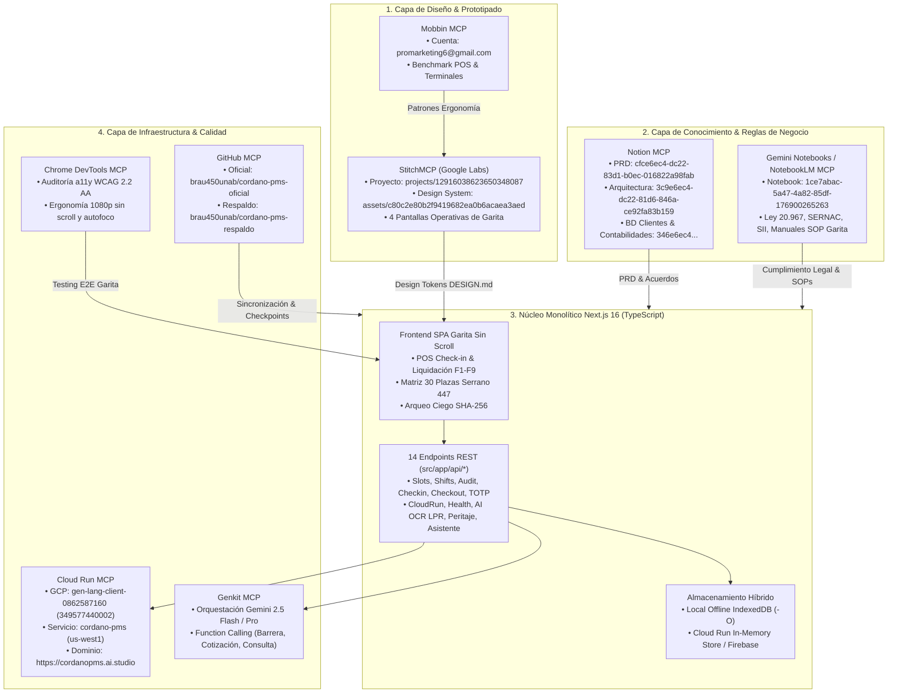

# Ecosistema de Protocolos MCP & Matriz de Integración Canónica
## ParkOps PMS & ERP (Cordano Inversiones Inmobiliarias Ltda.)
**Versión de Plataforma**: 4.5.0 Enterprise  
**Fecha de Actualización**: Octubre 2026  
**Entorno Principal**: Cloud Run (`us-west1`) / Next.js 16 / TypeScript / Google AI Studio / Google Stitch  

---

## 1. Visión General de la Arquitectura MCP

El sistema **ParkOps PMS & ERP** utiliza una arquitectura asistida por agentes fundamentada en el protocolo abierto **Model Context Protocol (MCP)**. Esta infraestructura interconecta herramientas de diseño visual, motores de orquestación de IA, observabilidad de infraestructura cloud, repositorios de código y bases de datos canónicas de conocimiento y requerimientos.



---

## 2. Ficha Técnica de Servidores MCP Configurados

A continuación se detalla la configuración activa registrada en el archivo central `C:\Users\BraulioAM\.gemini\config\mcp_config.json`:

### 2.1 StitchMCP (Google Labs Stitch)
- **Tipo de Conexión**: Endpoint remoto SSE (`mcp-remote`)
- **Comando de Configuración**:
  ```json
  "StitchMCP": {
    "command": "npx",
    "args": [
      "-y",
      "mcp-remote",
      "https://stitch.googleapis.com/mcp",
      "--header",
      "X-Goog-Api-Key: [REDACTED_GOOGLE_STITCH_API_KEY]"
    ]
  }
  ```
- **Proyecto Activo Oficial**: `projects/12916038623650348087` (*NUEVO PMS CORDANO - ParkOps Iquique*)
- **URL Web Stitch**: `https://stitch.withgoogle.com/projects/12916038623650348087`
- **Design System Asset**: `assets/c80c2e80b2f9419682ea0b6acaea3aed` (basado en `DESIGN.md`)
- **Pantallas Oficiales Generadas**:
  1. *POS Check-in & Vehículos en Turno*: ID `d09c4b80583e4978a4cb2630441bd485`
  2. *Plano 2D Arquitectónico con Bloques A y C*: ID `83e3e5b92d9645ed920a1a94c21c5e7a`
  3. *Proceso de Salida & Calculadora Gigante de Vuelto*: ID `16aa7c649bbc45eaab47c4bcb7879ae6`
  4. *Cierre de Caja Ciego en 3 Columnas & SHA-256*: ID `3b4892334a8744148bc67cbd67e7f9cf`
- **Proyectos Históricos de Referencia**:
  - `projects/11170226797373845541` (referencia de flujos previos proporcionada por el usuario)
  - `projects/10292600008632163693` (prototipo preliminar)
- **Herramientas Disponibles**: `create_project`, `get_project`, `list_projects`, `list_screens`, `get_screen`, `generate_screen_from_text`, `edit_screens`, `create_design_system`, `apply_design_system`.

---

### 2.2 Notion MCP (`@notionhq/notion-mcp-server`)
- **Tipo de Conexión**: Servidor STDIO local mediante paquete oficial Notion.
- **Configuración**:
  ```json
  "notion-mcp-server": {
    "command": "npx",
    "args": [
      "-y",
      "@notionhq/notion-mcp-server"
    ],
    "env": {
      "OPENAPI_MCP_HEADERS": "{\"Authorization\": \"Bearer [REDACTED_NOTION_INTEGRATION_TOKEN]\", \"Notion-Version\": \"2022-06-28\"}"
    }
  }
  ```
- **Páginas y Bases de Datos Conectadas**:
  - **PRD Sistema de Parking**: UUID `cfce6ec4-dc22-83d1-b0ec-016822a98fab` -> Replicado en `docs/PRD_SISTEMA_DE_PARKING.md`.
  - **Plan de Arquitectura y Roadmap**: UUID `3c9e6ec4-dc22-81d6-846a-ce92fa83b159` -> Replicado en `docs/PLAN_DE_ARQUITECTURA.md`.
  - **Base de Datos de Clientes & Contabilidades Cordano**: UUID `346e6ec4-dc22-8233-9c5e-01d1eb149c97` -> Alimenta `#view-clients` y `/api/clients`.
  - **Minutas y Acuerdos de Negocio**: Replicado en `docs/HISTORIAL_REUNIONES_Y_ACUERDOS.md`.
- **Herramientas Disponibles**: `API-retrieve-a-page`, `API-retrieve-page-markdown`, `API-retrieve-a-database`, `API-query-data-source`, `API-post-search`, etc.

---

### 2.3 Gemini Notebooks / NotebookLM MCP (`notebooklm` & Datacloud)
- **Tipo de Conexión**: Servidor local CLI `@m4ykeldev/notebooklm-mcp` + proxy Datacloud.
- **Configuración**:
  ```json
  "notebooklm": {
    "command": "npx",
    "args": [
      "-y",
      "@m4ykeldev/notebooklm-mcp",
      "serve"
    ]
  }
  ```
- **Notebook Oficial del Proyecto**:
  - **URL**: `https://notebook.google.com/notebook/1ce7abac-5a47-4a82-85df-176900265263`
  - **ID de Cuaderno**: `1ce7abac-5a47-4a82-85df-176900265263`
- **Ámbitos de Conocimiento**:
  - *Cumplimiento Legal*: Ley N° 20.967 (cobro fraccionado por minuto, base inicial de 30 min, 0 minutos de gracia post liquidación).
  - *SERNAC & SII*: Normas de comprobante de ingreso, rotulación tarifaria visible y recargos por ticket extraviado ($8.000 CLP).
  - *Manuales SOP Garita*: Protocolos de contingencia offline, apertura con fondo fijo ($50.000 CLP), resolución de incidencias en barrera y peritaje preventivo.
- **Herramientas Disponibles**: `notebook_list`, `notebook_get`, `notebook_query`, `source_describe`, `source_get_content`, `notebook_add_url`, etc.

---

### 2.4 GitHub MCP (`@modelcontextprotocol/server-github`)
- **Tipo de Conexión**: STDIO mediante paquete oficial de GitHub.
- **Configuración**:
  ```json
  "github-mcp-server": {
    "command": "npx",
    "args": [
      "-y",
      "@modelcontextprotocol/server-github"
    ],
    "env": {
      "GITHUB_PERSONAL_ACCESS_TOKEN": "[REDACTED_GITHUB_PERSONAL_ACCESS_TOKEN]"
    }
  }
  ```
- **Repositorios Vinculados**:
  - **Producción Oficial**: `brau450unab/cordano-pms-oficial` (main branch desplegada hacia Cloud Run y Google AI Studio).
  - **Respaldo Histórico**: `brau450unab/cordano-pms-respaldo` (snapshots atómicos y tags `checkpoint-*`).
- **Herramientas Disponibles**: `create_or_update_file`, `push_files`, `list_commits`, `create_branch`, `create_pull_request`, `search_code`, etc.

---

### 2.5 Cloud Run MCP (`@google-cloud/cloud-run-mcp`)
- **Tipo de Conexión**: STDIO con CLI de GCP / Cloud Run.
- **Configuración**:
  ```json
  "cloudrun": {
    "command": "npx",
    "args": [
      "-y",
      "@google-cloud/cloud-run-mcp"
    ]
  }
  ```
- **Parámetros del Despliegue**:
  - **Proyecto GCP**: `gen-lang-client-0862587160` (N° `349577440002`)
  - **Región**: `us-west1` (Oregon)
  - **Microservicio**: `cordano-pms` en puerto `8080`
  - **URLs de Producción**:
    - Cloud Run Direct: `https://cordano-pms-349577440002.us-west1.run.app`
    - Dominio Oficial: `https://cordanopms.ai.studio`
  - **Contenedor Base**: `gcr.io/gen-lang-client-0862587160/cordano-pms-2026:latest`
- **Herramientas Disponibles**: `list_services`, `get_service`, `get_service_log`, `deploy_container_image`.

---

### 2.6 Chrome DevTools MCP (`chrome-devtools-mcp`)
- **Tipo de Conexión**: Servidor STDIO con Puppeteer/Chrome DevTools Protocol.
- **Configuración**:
  ```json
  "chrome-devtools-mcp": {
    "command": "npx",
    "args": [
      "-y",
      "chrome-devtools-mcp@latest"
    ]
  }
  ```
- **Misión Operativa en Garita**:
  - Validación de diseño sin scroll vertical en pantallas 1080p y 4K para `#view-pos`.
  - Comprobación de autofoco inmediato en campo de patente al abrir cobro o ingreso.
  - Auditoría de accesibilidad WCAG 2.2 AA (contraste de chips cromáticos de plazas, tipografía tabular `font-mono`).
  - Verificación funcional de atajos de teclado `F1` a `F9`.
- **Herramientas Disponibles**: `navigate_page`, `take_screenshot`, `click`, `press_key`, `type_text`, `evaluate_script`, `lighthouse_audit`.

---

### 2.7 Genkit MCP Server (`genkit-cli`)
- **Tipo de Conexión**: CLI STDIO para flujos Genkit / Gemini SDK.
- **Configuración**:
  ```json
  "genkit-mcp-server": {
    "command": "npx",
    "args": [
      "-y",
      "genkit-cli@^1.28.0",
      "mcp",
      "--explicitProjectRoot",
      "--no-update-notification",
      "--non-interactive"
    ]
  }
  ```
- **Misión en ParkOps**:
  - Orquestación multimodal para reconocimiento LPR de patentes chilenas/Mercosur (`/api/ai/lpr-ocr`).
  - Detección preventiva de daños mecánicos o carrocería en acceso (`/api/ai/damage-inspection`).
  - Auditoría financiera de turnos de caja ciega con hash SHA-256 (`/api/ai/shift-audit`).
  - Function calling operativo para apertura de barrera (`triggerBarrierPulse`), tarificación y telemetría (`/api/ai/tools`).
- **Herramientas Disponibles**: `list_flows`, `run_flow`, `get_trace`.

---

### 2.8 Mobbin MCP
- **Tipo de Conexión**: Endpoint API remoto `https://api.mobbin.com/mcp`
- **Cuenta Registrada**: `promarketing6@gmail.com`
- **Misión**: Referencias visuales de UX y flujos de trabajo de terminales POS móviles y desktop para garita.

---

## 3. Matriz de Relaciones: MCPs, Código Fuente y Documentación

| Protocolo MCP | Archivos de Configuración / Código | Endpoints Backend Conectados | Vistas Frontend Afectadas | Documentación de Respaldo |
| :--- | :--- | :--- | :--- | :--- |
| **StitchMCP** | `DESIGN.md`, `tailwind.config.ts`, `ecosystem-manager.mjs` | `/api/docs` | Todas (`#view-landing`, `#view-pos`, `#view-map`, `#modal-*`) | `docs/VISTAS_STITCH_CORDANO.md`, `docs/stitch/` |
| **Notion MCP** | `src/app/api/clients/route.ts`, `src/types/pms.ts` | `/api/clients`, `/api/docs` | `#view-clients` (`[F3]`), `#view-support` | `docs/PRD_SISTEMA_DE_PARKING.md`, `docs/PLAN_DE_ARQUITECTURA.md` |
| **NotebookLM MCP** | `src/app/api/ai/assistant/route.ts`, `src/lib/pmsStore.ts` | `/api/ai/assistant`, `/api/ai/tools` | `#view-support`, `#modal-ticket` | `docs/PARKOPS_ESPECIFICACIONES_TECNICAS_V2.md` |
| **Cloud Run MCP** | `service.yaml`, `Dockerfile`, `deploy-cloudrun.bat` | `/api/cloudrun`, `/api/health` | TopBar (Badge estado), `#view-settings` (`[F5]`) | `AGENTS.md`, `GEMINI.md`, `DOCUMENTO_CENTRALIZADO...` |
| **GitHub MCP** | `ecosystem-manager.mjs`, `sync_to_github_ai_studio.mjs` | N/A (CI/CD) | N/A (Control de Versiones) | `README.md`, Git commit history |
| **Chrome DevTools MCP**| Tests E2E, scripts de validación | N/A (Testing a11y) | `#view-pos` (Garita sin scroll) | Reportes de accesibilidad |
| **Genkit MCP** | `src/app/api/ai/*`, `lib/aiStudio.ts` | `/api/ai/lpr-ocr`, `/api/ai/damage-inspection`, `/api/ai/shift-audit` | `#pos-subtab-entry` (`[LPR IA]`, `[Peritaje IA]`), `#modal-close-shift` | `docs/FLUJO_OPERATIVO_OPERADOR_PARKOPS.md` |
| **Mobbin MCP** | `stitch_designs/`, `docs/stitch/` | N/A | Mockups y Wireframes | `MOBBIN_AND_STITCH_INTEGRATION.md` |
| **Google Authenticator (RFC 6238)** | `src/lib/totp.ts`, `src/lib/pmsStore.ts` | `/api/auth/totp`, `/api/audit` | `#modal-pin-auth`, `/admin/usuarios` | `docs/PARKOPS_ESPECIFICACIONES_TECNICAS_V2.md` |

---

## 4. Guía Operativa para Agentes Asistentes

Para mantener la integridad del sistema al realizar cambios asistidos por IA:

1. **Antes de modificar UI o componentes en `src/components/*`**:
   - Consultar `DESIGN.md` y verificar tokens en Stitch (`projects/12916038623650348087`).
   - Respetar la regla de **cero scroll en 1080p** para la garita y **tipografía monoespaciada tabular** (`font-mono`, `tabular-nums`) para todo monto en CLP y patente.

2. **Antes de modificar reglas de negocio, tarifas o turnos**:
   - Revisar `docs/PRD_SISTEMA_DE_PARKING.md` (Notion) y contrastar con el marco legal en `NotebookLM` (`https://notebook.google.com/notebook/1ce7abac-5a47-4a82-85df-176900265263`).
   - Recordar que **el Administrador no abre caja** y que los convenios mensuales / pernocta nocturna operan en el submódulo en paralelo (`#view-clients`) sin alterar la contabilidad rotativa por minuto.

3. **Antes de desplegar o realizar commits a producción**:
   - Utilizar el script unificado:
     ```powershell
     node ecosystem-manager.mjs checkpoint "pre-deploy-ajuste"
     node ecosystem-manager.mjs sync-oficial "feat: sincronización de pantallas y contratos"
     ```
   - Si se requiere publicación en Cloud Run:
     ```powershell
     node ecosystem-manager.mjs deploy
     ```
