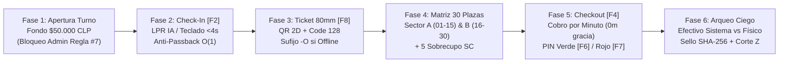

# Pipeline Idea-OS, Stitch UI Design & Magnific AI: ParkOps PMS & ERP v4.5

**Organización**: Cordano Inversiones Inmobiliarias Ltda.  
**Instalación Física**: Serrano 447, Iquique, Región de Tarapacá, Chile (~700 m², 30 plazas oficiales + 5 sobrecupo)  
**Infraestructura**: Google Cloud Run (`cordano-pms-v1`, proyecto `gen-lang-client-0862587160`, región `us-west1`, puerto `8080`)  
**Google Stitch Project**: `projects/12916038623650348087` (*NUEVO PMS CORDANO - ParkOps Iquique*)  
**Clasificación Idea-OS**: `T3 · S3` (New Product / Enterprise Vertical ERP · Full 5-Phase Pipeline)

---

## Fase 1 — Triage & Clasificación (`T3 · S3`)

- **Tipo de Iniciativa (`T3 — New Product / Greenfield Vertical PMS & ERP`)**: Plataforma monolítica modular en Next.js 16 (App Router) con persistencia híbrida Redis In-Memory (`<5ms`), Google Cloud Datastore (`Shifts`, `VehicleProfiles`, `AuditTrail`) y contingencia local `IndexedDB` (`-O`).
- **Escala de Complejidad (`S3 — Full Operational & Financial Audit`)**: Involucra hardware físico de garita (impresora térmica 80mm ESC/POS, lector 2D/Code 128, gaveta RJ11, cámara LPR), cumplimiento normativo chileno (Ley N° 20.967 SERNAC y DTE SII) y protocolo antifraude con firma criptográfica `SHA-256`.

---

## Fase 2 — Decisiones Clarificadoras & Contratos Cerrados (`01-questions`)

| Dimensión | Decisión Cerrada | Regla de Dominio Asociada |
| :--- | :--- | :--- |
| **1. Operación en Garita** | Flujo 100% asistido por teclado (`F1–F10`, `Enter`, `Esc`), autofoco inmediato en patente y **cero scroll** en 1080p. | Regla #1 (Ergonomía de Garita) |
| **2. Pliego Tarifario** | Cobro exacto por minuto con **0 minutos de gracia** (Ley 20.967): Sedán `$25/min`, SUV `$30/min`, Moto `$15/min`. | Regla #2 (`tabular-nums` + `font-mono`) |
| **3. Servicios en Paralelo** | Convenios Mensuales (`$75.000/mes`) y Pernocta Noche (`$8.000/noche`) bloquean plaza física sin sumar a la caja rotativa por minuto. | Regla #7 (Aislamiento Contable) |
| **4. Segregación RBAC** | El Administrador audita y autoriza multas/anulaciones con PIN (`9999`), pero **tiene prohibido abrir turnos de caja**. | Regla #7 (Incompatibilidad de Caja) |
| **5. Contingencia Offline** | En caso de corte de fibra en Iquique, el sistema emite tickets con sufijo **`O`** (`TKT-AAAAMMDD-T01-XXXXO`) y encola en `IndexedDB`. | Regla #4 (Resiliencia Offline-First) |

---

## Fase 3 — Investigación de Mercado, Regulación y Operación (`02-research`)

1. **Marco Legal Chileno (Ley N° 20.967 — Cobro de Estacionamientos)**:
   - Prohibición de redondeo al alza por bloques no consumidos; obligación de cobro por minuto efectivo (`$25`, `$30`, `$15` CLP/min).
   - Prohibición de eximir responsabilidad civil del recinto ante robos o daños; por ello se incorpora el **Peritaje Preventivo de Daños IA (`/api/ai/damage-inspection`)** al ingreso.
   - Multa reglamentaria por pérdida de ticket (`$8.000 CLP`) impresa obligatoriamente en el pie del ticket térmico de 80mm y sujeta a PIN de Administrador.
2. **Jobs-To-Be-Done (JTBD)**:
   - *Operador de Garita*: "Cuando ingresa una fila de vehículos en hora punta (12:00–15:30 hrs en Serrano 447), necesito registrar la patente e imprimir el ticket dual 80mm en menos de 4 segundos sin usar el mouse."
   - *Gerencia / Auditoría Cordano*: "Cuando finaliza un turno, necesito que el operador declare su efectivo a ciegas y que el cierre quede sellado con `SHA-256` para eliminar fugas de caja."

---

## Fase 4 — PRD: Objetivos, Non-Goals y Métricas (`03-prd`)

### Non-Goals (Fuera de Alcance Explícito)
- **No es una app de reservas para consumidores finales**: El sistema es de uso exclusivo en garita y administración interna de Serrano 447.
- **No mezcla contabilidad mensual con caja diaria**: Los abonos de `$75.000 CLP` no ingresan a la gaveta de sencillo del operador.
- **No depende de conexión permanente a internet**: Ninguna caída de red puede detener la apertura de barrera ni la impresión de tickets de 80mm.

### Métricas de Éxito (Leading & Lagging Indicators)
- **Leading Indicators**:
  - Tiempo medio de Check-in en garita: **< 4.0 segundos** (con autocompletado LPR IA o teclado).
  - Latencia de consulta `active_plates` anti-passback: **< 5 ms** en capa caliente.
- **Lagging Indicators**:
  - Discrepancia no auditada en arqueos de caja ciega: **$0 CLP** (100% de turnos sellados con `SHA-256`).
  - RevPAS (Revenue Per Available Space) en Serrano 447: **>= $11.400 CLP / plaza / día**.

---

## Fase 5 — Plan de Ejecución, Journey Mermaid y Kill Criteria (`04-plan`)

### Diagrama de Flujo Operativo en 6 Fases (Mermaid)

### Criterios de Corte y Calidad (Kill Criteria)
1. **Regla Cero Scroll en Garita**: Si el operador en monitor 1080p necesita hacer scroll vertical para emitir un ticket o cobrar una salida, el diseño de la vista POS se rechaza.
2. **Integridad Antifraude**: Si un descuento comercial puede aplicarse sin PIN de 4 dígitos o con una justificación de `<= 10` caracteres, el build se bloquea.
3. **Resiliencia Cloud Run**: Si el contenedor standalone supera los `512 MiB` de RAM o falla el healthcheck `/api/health` en puerto `8080`, el despliegue se revierte automáticamente.

---

## Catálogo Integrado Stitch UI Design (`12916038623650348087`) & Magnific AI (8K)

| ID Activo | Ruta en `public/` | Skill / Preset Aplicado | Propósito en la Plataforma |
| :--- | :--- | :--- | :--- |
| `engine-database-core` | `/assets/parkops/engine-database-core.jpg` | `archify` + `magnific-ai` (`4x-UltraSharp`) | Arquitectura híbrida Redis + Cloud Datastore + IndexedDB |
| `engine-garita-cockpit` | `/assets/parkops/engine-garita-cockpit.jpg` | `pms-erp-dashboard-design` + `magnific-ai` | Cockpit operativo 40/60 Garita Serrano 447 + LPR + 80mm |
| `engine-tariff-sha256` | `/assets/parkops/engine-tariff-sha256.jpg` | `frontend-design` + `stitch-ui-design` | Motor tarifario por minuto y arqueo ciego `SHA-256` |
| `serrano-447-hero` | `/assets/parkops/serrano-447-hero.jpg` | `magnific-ai` (`Preset B: Architecture`) | Vista aérea y fachada de Serrano 447 (30 plazas + 5 SC) |
| `hardware-garita-kit` | `/assets/parkops/hardware-garita-kit.jpg` | `magnific-ai` (`Preset A: Faithful`) | Kit físico: térmica 80mm, lector 2D, gaveta RJ11, POS, UPS |
| `lpr-cctv-vision` | `/assets/parkops/lpr-cctv-vision.jpg` | `magnific-ai` (`Preset C: CCTV LPR`) | Cámara LPR IA y peritaje óptico de daños Gemini Vision |
| `ui_garita_pos` | `/mockups/ui_garita_pos_y_layout_estacionamiento.jpg` | `stitch-ui-design` (`12916038623650348087`) | Lámina técnica Stitch: Garita POS 40/60 y Matriz 30 Plazas |
| `ui_menu_central` | `/mockups/ui_menu_central_launchpad_y_panel_control.jpg` | `stitch-ui-design` (`12916038623650348087`) | Lámina técnica Stitch: Launchpad Central y Panel Control |
| `ui_convenios_cctv` | `/mockups/ui_menu_lateral_convenios_usuarios_cctv.jpg` | `stitch-ui-design` (`12916038623650348087`) | Lámina técnica Stitch: Convenios en Paralelo, RBAC y CCTV |
| `ui_popups_ticket` | `/mockups/ui_popups_reportes_configuracion_ticket_pdf.jpg` | `stitch-ui-design` (`12916038623650348087`) | Lámina técnica Stitch: Modales PIN, Reporte Z y Ticket 80mm |
| `ui_landing_soporte` | `/mockups/ui_landing_login_manuales_soporte.jpg` | `stitch-ui-design` (`12916038623650348087`) | Lámina técnica Stitch: Portal de Acceso, Login y Manuales SOP |
