# Mapa de Sitio, Arquitectura de Rutas Canónicas y Contratos de API v4.5 (ParkOps PMS & ERP)

> **Organización**: Cordano Inversiones Inmobiliarias Ltda. (Serrano 447, Iquique, Chile)  
> **Proyecto**: ParkOps PMS & ERP v4.5 (`CORDANO-PMS-2026`)  
> **Arquitectura**: Next.js 16 App Router + Monolito Isomórfico (Client Routing `history.pushState` / Offline-First)  
> **Compatibilidad Dual**: App Router server/client y Bundle estático HTML para Google AI Studio (`PARKOPS_FRONTEND_GOOGLE_AI_STUDIO.html`)

---

## 1. Arquitectura de Rutas Canónicas (URLs) - Matriz de 7 Secciones y 20 Rutas

ParkOps PMS & ERP implementa un esquema canónico de URLs jerárquicas y amigables. Cada ruta está sincronizada mediante el motor `routerSync.ts`, permitiendo acceso directo por barra de direcciones, bookmarks, navegación con botón atrás/adelante (`popstate`) y atajos de teclado (`F1`–`F10`).

```mermaid
flowchart TD
    App["ParkOps PMS & ERP (Serrano 447)"]
    
    App --> S1["1. Portal Público & Autenticación"]
    App --> S2["2. Terminal Operativa (Core POS)"]
    App --> S3["3. Servicios Especiales (Paralelo)"]
    App --> S4["4. Analítica y Telemetría"]
    App --> S5["5. Auditoría y Finanzas"]
    App --> S6["6. Configuración y Hardware"]
    App --> S7["7. Centro de Ayuda y Aprendizaje"]

    S1 --> R1["/ (Portal Comercial & Garita)"]
    S1 --> R2["/login (Acceso Seguro con PIN RBAC)"]
    S1 --> R3["/menu (Menú Principal & Checklist F1)"]

    S2 --> R4["/pos (Ingreso Rápido Vehicular F2)"]
    S2 --> R5["/pos/salida (Liquidación & Vuelto F4)"]
    S2 --> R6["/pos/historial (Historial del Turno F6)"]
    S2 --> R7["/pos/matriz (Matriz 2D de Plazas A/B)"]

    S3 --> R8["/servicios/convenios (Convenios Corporativos F3)"]
    S3 --> R9["/servicios/estadia-nocturna (Custodia Pernocta)"]

    S4 --> R10["/analitica/dashboard (RevPAS & ALOS)"]
    S4 --> R11["/analitica/heatmaps (Mapas de Calor Semanal)"]
    S4 --> R12["/analitica/motor-bd (Motor Híbrido BD & Archify F10)"]

    S5 --> R13["/auditoria/arqueo-ciego (Arqueo 3 Pasos SHA-256 F9)"]
    S5 --> R14["/auditoria/reportes-z (Cortes Z Fiscales 80mm)"]
    S5 --> R15["/auditoria/transacciones (Bitácora Verde/Rojo PIN)"]
    S5 --> R16["/auditoria/exportar (Descarga CSV UTF-8 BOM)"]

    S6 --> R17["/ajustes/general (Ficha Recinto Serrano 447)"]
    S6 --> R18["/ajustes/tarifas (Tarifario Ley 20.967 F5)"]
    S6 --> R19["/ajustes/hardware (Impresora 80mm, RJ11, Barrera)"]
    S6 --> R20["/ajustes/contingencia (Offline-First Sufijo -O)"]

    S7 --> R21["/soporte (Buscador Predictivo & Ayuda)"]
    S7 --> R22["/soporte/sops (Procedimientos Canónicos SOP-01..06)"]
    S7 --> R23["/soporte/showroom (Showroom Interactivo)"]
    S7 --> R24["/soporte/documentacion (PRDs y Contratos /api/docs)"]
```

---

## 2. Detalle Exhaustivo de las 7 Secciones y Rutas Canónicas

### Sección 1: Portal Público y Autenticación
| Ruta Canónica | Vista Interna | Atajo | Función Operativa y Descripción |
| :--- | :--- | :--- | :--- |
| **`/`** | `landing` | `Esc` | **Portal Comercial & Garita**: Landing informativa, cuadro tarifario oficial Ley 20.967 y conmutador visual Wireframe / 8K IA. |
| **`/login`** | `landing` (sección login) | — | **Acceso Seguro Garita**: Control de acceso RBAC (Operador vs. Administrador) y declaración de fondo inicial de caja. |
| **`/menu`** | `menu` | `F1` | **Menú Operativo & Apertura**: Dashboard principal de garita, 4 KPIs vivos y checklist obligatorio de 6 puntos. |

### Sección 2: Terminal Operativa (Core POS Garita)
| Ruta Canónica | Vista Interna | Subpestaña / Dim | Atajo | Función Operativa y Descripción |
| :--- | :--- | :--- | :--- | :--- |
| **`/pos`** | `pos` | `subtab: 'entry'` | `F2` | **Ingreso Rápido Garita**: Registro de patente en `<4s` con autofoco inmediato, asignación de plaza y 0m gracia. |
| **`/pos/salida`** | `pos` | `subtab: 'exit'` | `F4` | **Liquidación y Cobro**: Búsqueda por patente/ticket, cálculo tabular de estadía, desglose IVA 19% y calculadora de vuelto. |
| **`/pos/historial`** | `pos` | `subtab: 'history'` | `F6` | **Historial del Turno**: Registro correlativo de tickets emitidos y cobrados en la jornada activa. |
| **`/pos/matriz`** | `map` | `dimension: 'matrix'` | `Plano` | **Matriz 2D de Plazas**: Grilla visual de 30 plazas físicas (Sectores A y B) con código semántico de 7 colores. |

### Sección 3: Servicios Especiales (Submódulo en Paralelo)
| Ruta Canónica | Vista Interna | Atajo | Función Operativa y Descripción |
| :--- | :--- | :--- | :--- |
| **`/servicios/convenios`** | `clients` | `F3` | **Convenios Corporativos Mensuales**: Gestión de abonados (`$75.000 CLP/mes`). Bloquea plaza sin sumar a caja rotativa del día. |
| **`/servicios/estadia-nocturna`** | `clients` | — | **Custodia Pernocta**: Registro de estadía nocturna (`$8.000 CLP` tarifa plana, 21:00 a 08:00 hrs) con contrato de custodia. |

### Sección 4: Analítica y Telemetría
| Ruta Canónica | Vista Interna | Dimensión | Atajo | Función Operativa y Descripción |
| :--- | :--- | :--- | :--- | :--- |
| **`/analitica/dashboard`** | `map` | `hourly` | — | **Dashboard RevPAS & Ocupación**: Métricas clave (`RevPAS $11.417`, `ALOS 51m`, rotación `1.60x`) y facturación por franjas. |
| **`/analitica/heatmaps`** | `map` | `heatmap` | — | **Mapas de Calor Semanales**: Ocupación por día/hora e identificación de ventana peak (12:00 a 15:30 hrs). |
| **`/analitica/motor-bd`** | `engine` | — | `F10` | **Consola Motor Híbrido & Archify**: Métricas de Hot Cache Redis `<5ms`, Cloud Datastore Kinds y cola IndexedDB `-O`. |

### Sección 5: Auditoría y Finanzas
| Ruta Canónica | Vista Interna | Atajo | Función Operativa y Descripción |
| :--- | :--- | :--- | :--- |
| **`/auditoria/arqueo-ciego`** | `reports` | `F9` | **Arqueo Ciego de Caja**: Cierre en 3 pasos con conteo físico, conciliación determinista y firma criptográfica `SHA-256`. |
| **`/auditoria/reportes-z`** | `reports` | — | **Reportes Z Fiscales**: Emisión e impresión térmica en 80mm de cortes Z tributarios inmutables. |
| **`/auditoria/transacciones`** | `reports` | — | **Bitácora Antifraude**: Eventos auditados con PIN: Verde (descuentos Operador) y Rojo (ticket perdido/fuga Admin). |
| **`/auditoria/exportar`** | `reports` | — | **Exportación ERP**: Descarga directa de planilla de transacciones en formato CSV UTF-8 BOM (`/api/export/sheets`). |

### Sección 6: Configuración y Hardware (Ajustes)
| Ruta Canónica | Vista Interna | Atajo | Función Operativa y Descripción |
| :--- | :--- | :--- | :--- |
| **`/ajustes/general`** | `settings` | — | **Ficha Serrano 447**: Datos de infraestructura física (30 plazas + 5 sobrecupos, 700 m²) y razón social Cordano Ltda. |
| **`/ajustes/tarifas`** | `settings` | `F5` | **Tarifario Ley 20.967**: Configuración de valor por minuto (Sedán `$25`, SUV `$30`, Moto `$15`) y recargo extravío `$8.000`. |
| **`/ajustes/hardware`** | `settings` | — | **Periféricos de Garita**: Diagnóstico de impresora térmica 80mm ESC/POS, escáner 2D, gaveta RJ11 y barrera. |
| **`/ajustes/contingencia`** | `settings` | — | **Contingencia Offline & Cloud Run**: Conmutador de modo offline (`-O`), telemetría de latencia GCP y sincronización automática. |

### Sección 7: Centro de Ayuda y Ecosistema de Aprendizaje
| Ruta Canónica | Vista Interna | Atajo | Función Operativa y Descripción |
| :--- | :--- | :--- | :--- |
| **`/soporte`** | `support` | — | **Centro de Ayuda Global**: Buscador predictivo de procedimientos de garita, preguntas frecuentes y asistencia. |
| **`/soporte/sops`** | `support` | — | **Manuales Operativos SOP**: Procedimientos canónicos (SOP-01 a SOP-06) para garita. |
| **`/soporte/showroom`** | `support` | — | **Showroom Interactivo**: Recorrido interactivo guiado por todos los módulos del sistema. |
| **`/soporte/documentacion`** | `support` | — | **Documentación Técnica Canónica**: Visor directo de PRDs, especificaciones técnicas y contratos de API (`/api/docs`). |

---

## 3. Matriz de Atajos de Teclado de Garita (`Keyboard-First`)

| Atajo | Acción Operativa Inmediata | Destino URL Canónico |
| :--- | :--- | :--- |
| **`Esc`** | Volver al Portal Comercial o cerrar modal activo | `/` |
| **`F1`** | Abrir Menú Principal Operativo & Checklist | `/menu` |
| **`F2`** | Abrir Ingreso Rápido de Garita con autofoco en patente | `/pos` |
| **`F3`** | Abrir Módulo de Convenios y Servicio Noche en paralelo | `/servicios/convenios` |
| **`F4`** | Abrir Liquidación y Cobro de Salida con autofoco | `/pos/salida` |
| **`F5`** | Abrir Configuración y Tarifario Ley 20.967 | `/ajustes/tarifas` |
| **`F6`** | Abrir Historial de Tickets / Modal Descuento Comercial | `/pos/historial` |
| **`F7`** | Modal Ticket Extraviado (`+$8.000 CLP`, PIN Admin) | Excepción de Cobro |
| **`F8`** | Disparar Impresión Térmica 80mm (QR + Code 128) | Periférico Garita |
| **`F9`** | Iniciar Arqueo Ciego de Caja (3 Pasos, SHA-256) | `/auditoria/arqueo-ciego` |
| **`F10`** | Consola Motor Híbrido BD & Archify | `/analitica/motor-bd` |
| **`Ctrl+K` / `⌘K`** | Abrir Command Palette Global de Garita | Búsqueda Global |
| **`Enter`** | Confirmar ingreso de vehículo o liquidar pago | Formularios POS |

---

## 4. Contratos de los 14 Endpoints de API (`src/app/api/*`)

### 4.1 Core Transaccional PMS & Motor Híbrido
1. **`GET /api/slots`**: Retorna las 30 plazas (`A-01..A-15`, `B-16..B-30`) + 5 sobrecupos, contadores de ocupación y estado `offlineMode`.
2. **`POST /api/checkin`**: Valida formato de patente, previene doble ingreso (*Anti-Passback*), asigna plaza y genera correlativo `TKT-AAAAMMDD-T0X-XXXX` (o sufijo `O`).
3. **`POST /api/checkout`**: Calcula estadía exacta con **0 minutos de gracia**, aplica descuentos (con PIN Operador) o recargo por extravío de `$8.000 CLP` (con PIN Admin), registra medio de pago y libera la plaza.
4. **`GET / POST /api/shifts`**: Gestiona apertura de turno con fondo inicial de `$50.000 CLP` y cierre de caja ciega sellado con `SHA-256`.
5. **`GET / POST /api/audit`**: Almacena y consulta eventos de auditoría antifraude clasificados por `color_tag` (`VERDE`, `ROJO`, `AZUL`, `GRIS`).
6. **`GET / POST /api/engine`**: Retorna telemetría en vivo del Motor Híbrido (Redis In-Memory Hot Cache `<5ms`, Google Cloud Datastore Kinds `Shifts`, `VehicleProfiles`, `AuditTrail` y cola IndexedDB `-O`), ejecutando acciones transaccionales (`REBUILD_REDIS_INDEX`, `SNAPSHOT_DATASTORE`, `FLUSH_SYNC_QUEUE`).

### 4.2 Inteligencia Artificial Operativa (Gemini 2.5 Flash)
7. **`POST /api/ai/lpr-ocr`**: Servicio LPR multimodal para lectura de patentes desde imágenes.
8. **`POST /api/ai/damage-inspection`**: Redacción asistida de actas de peritaje para daños preexistentes en vehículos (SOP-03).
9. **`POST /api/ai/shift-audit`**: Auditoría financiera de cierre de turno con dictamen de riesgo (`BAJO | MEDIO | ALTO`).
10. **`POST /api/ai/assistant`**: Asistente de consultas para procedimientos operativos y normativas legales (SOPs, Ley 20.967).
11. **`POST /api/ai/tools`**: *Function Calling* estructurado (`getParkingStatus`, `calculateParkingFee`, `triggerBarrierPulse`).

### 4.3 Infraestructura Cloud Run, Documentación y Exportación ERP
12. **`GET /api/cloudrun`**: Metadatos del microservicio `cordano-pms` en Google Cloud Run (`us-west1`).
13. **`GET /api/health`**: Verificación de salud y latencia RTT del contenedor.
14. **`GET /api/docs` & `GET /api/export/sheets`**: Visor de PRDs y descarga dinámica de planilla CSV contable UTF-8 BOM.
