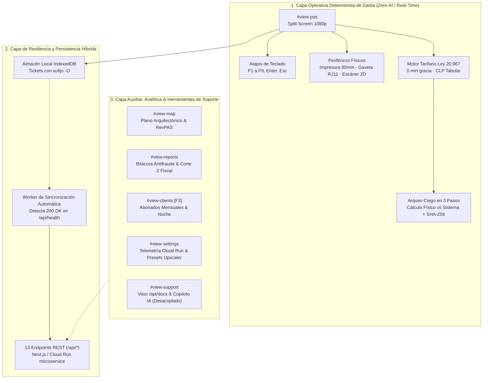
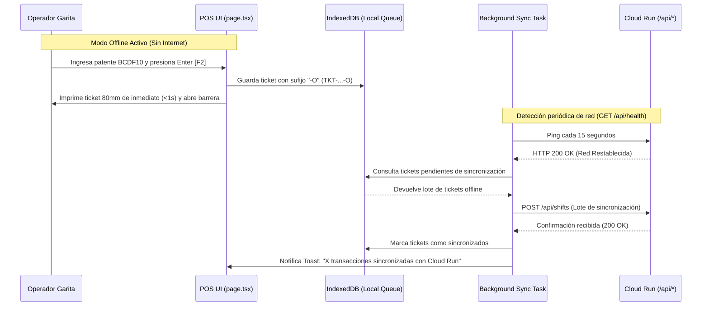

# Plan de Arquitectura Modular & Convenciones del Sistema: ParkOps PMS & ERP

**Proyecto**: ParkOps PMS & ERP Enterprise v4.5  
**Entorno de Ejecución**: Google Cloud Run (`cordano-pms-v1`, `us-west1`) / Next.js 16 App Router / Standalone Google AI Studio  
**Cliente**: Cordano Inversiones Inmobiliarias Ltda. (Serrano 447, Iquique)  
**Fecha**: Octubre 2026  

---

## 1. Principios de Arquitectura y Separación de Capas

El sistema se estructura bajo una **Arquitectura Monolítica Modular y Resiliente (Offline-First)** que desacopla estrictamente dos dominios funcionales:



### Regla Fundamental de Aislamiento:
- **La Capa Operativa de Garita NO depende de Inteligencia Artificial para funcionar**. Toda transacción en caja es síncrona, determinista y opera en milisegundos mediante código local y contratos REST o almacén local `IndexedDB`.
- Las llamadas a modelos de IA (Gemini 2.5 Flash) se confinan exclusivamente a `#view-support` y auditorías a posteriori, sin bloquear jamás el paso vehicular en garita.

---

## 2. Inventario de Estructura de Archivos y Responsabilidades

```
c:/Users/.../NUEVO PMS CORDANO/
├── docs/                                          # Documentación canónica y especificaciones
│   ├── DOCUMENTO_CENTRALIZADO_ESTRUCTURA_Y_DIRECTRICES_PARKOPS.md
│   ├── UX_FLOW_AND_INFORMATION_ARCHITECTURE.md   # Arquitectura de información y flujos
│   ├── PLAN_DE_ARQUITECTURA_MODULAR_V4.md        # Este documento de arquitectura
│   └── PRD_SISTEMA_DE_PARKING.md                 # PRD funcional del parking
├── public/                                        # Activos estáticos
│   └── assets/parkops/                            # Renders 8K IA y fotografía de producto
│       ├── serrano-447-hero.jpg                   # Render arquitectónico Serrano 447
│       ├── hardware-garita-kit.jpg                # Foto estudio kit garita (80mm, gaveta, POS)
│       └── lpr-cctv-vision.jpg                    # Captura visual cámara de acceso
├── src/
│   ├── app/
│   │   ├── api/                                   # 13 Endpoints REST del Backend
│   │   │   ├── slots/route.ts                     # Estado de 30 plazas + 5 sobrecupo
│   │   │   ├── checkin/route.ts                   # Ingreso de vehículos (Anti-Passback)
│   │   │   ├── checkout/route.ts                  # Salida vehicular (Tarifas Ley 20.967)
│   │   │   ├── shifts/route.ts                    # Ciclo de turno de caja (Apertura/Cierre)
│   │   │   ├── audit/route.ts                     # Bitácora antifraude PIN (Verde/Rojo)
│   │   │   ├── cloudrun/route.ts                  # Telemetría y estado de microservicio GCP
│   │   │   ├── health/route.ts                    # Healthcheck y métricas vivas
│   │   │   ├── docs/route.ts                      # Servidor en vivo de documentos /docs
│   │   │   ├── export/sheets/route.ts             # Exportador dinámico CSV / Sheets
│   │   │   └── ai/                                # Endpoints desacoplados de IA auxiliar
│   │   │       ├── assistant/route.ts             # Copiloto de soporte
│   │   │       ├── tools/route.ts                 # Function calling operativo
│   │   │       ├── lpr-ocr/route.ts               # OCR LPR experimental
│   │   │       └── shift-audit/route.ts           # Auditoría financiera a posteriori
│   │   ├── globals.css                            # Estilos globales y tokens Tailwind
│   │   ├── layout.tsx                             # Shell HTML y metadatos de aplicación
│   │   └── page.tsx                               # Orquestador principal de la SPA
│   ├── components/
│   │   ├── official/                              # Componentes modulares oficiales
│   │   │   ├── OfficialLandingAndMenu.tsx         # Portal de garita, login RBAC y KPIs
│   │   │   ├── OfficialAuxViews.tsx               # Vistas auxiliares (Mapa, Reportes, etc.)
│   │   │   └── OfficialModals.tsx                 # Modales seguros (Ticket, PIN, Cierre)
│   │   └── navigation/                            # Módulo de Navegación Desacoplada
│   │       └── CollapsibleSidebar.tsx             # Sidebar lateral colapsable (Dock ERP)
│   └── lib/                                       # Helpers, validadores y almacén en memoria
│       ├── pmsStore.ts                            # Estado centralizado del PMS en memoria
│       └── indexedDbSync.ts                       # Cola offline-first y background sync
├── BRIEF.md                                       # Resumen ejecutivo de decisiones UX
├── PARKOPS_FRONTEND_GOOGLE_AI_STUDIO.html         # Bundle autónomo para Google AI Studio
└── service.yaml                                   # Manifiesto Cloud Run Gen2
```

---

## 3. Desacoplamiento de la Navegación: Sidebar Lateral Colapsable (Dock ERP)

Para responder a la directriz aprobada en Grill-Me UI, la navegación migra a un componente lateral dedicado que se integra sin romper la compatibilidad con los atajos de teclado (`F1` a `F9`):

### Especificación del Componente `CollapsibleSidebar`:
- **Modo Colapsado (Predeterminado)**:
  - Ancho: `w-16` (64px).
  - Muestra iconos limpios en SVG, indicadores de vista activa con acento oscuro (`bg-slate-900 text-white`) y badges monoespaciados de atajos de teclado (`[F1]`, `[F2]`, `[F3]`, etc.).
  - Tooltips flotantes al hacer hover (`shortcut-tooltip`) para no saturar la pantalla.
  - Maximiza el área horizontal para el POS Split-Screen y la matriz de plazas.
- **Modo Expandido (Opcional por Toggle)**:
  - Ancho: `w-56` (224px).
  - Despliega etiquetas completas (*"Menú General"*, *"Garita POS"*, *"Abonados & Noche"*, *"Configuración"*, etc.) para supervisores o auditorías.
- **Barra de Estado Superior Complementaria (Compacta `h-12`)**:
  - Aloja elementos de telemetría de garita:
    - Logo Cordano Inversiones.
    - Reloj de turno en vivo (`01:42:15`).
    - Indicador de estado `GARITA 01` / `OFFLINE (-O)`.
    - Acceso rápido a búsqueda global de patente (`Ctrl+K` / `⌘K`).
    - Gatillo directo de apertura de barrera (`F9` / `F8`).
    - Botón de cierre de turno (Arqueo Ciego).
    - Conmutador visual permanente `[📐 Wireframe]` / `[🖼️ Renders HD IA]`.

---

## 4. Persistencia Híbrida y Sincronización Automática en Background

La resiliencia de datos se garantiza a través de una máquina de estados de sincronización:



---

## 5. Criterios de Rendimiento, Seguridad y Auditoría

1. **Latencia en Garita**:
   - Todo render o actualización de estado en `#view-pos` se procesa en menos de **16 milisegundos** (60 FPS estables sin bloqueos).
2. **Inmutabilidad Financiera**:
   - Toda anulación, descuento o cobro de ticket perdido genera una entrada inalterable en `/api/audit` con sello de tiempo ISO y clasificador de color (`VERDE` para descuentos, `ROJO` para pérdidas y cargos extraordinarios).
3. **Cero Dependencia de Terceros en Producción de Garita**:
   - Toda la suite de iconos y tipografías está embebida o servida localmente; no existen llamadas bloqueantes a CDNs externas en el path operativo.
