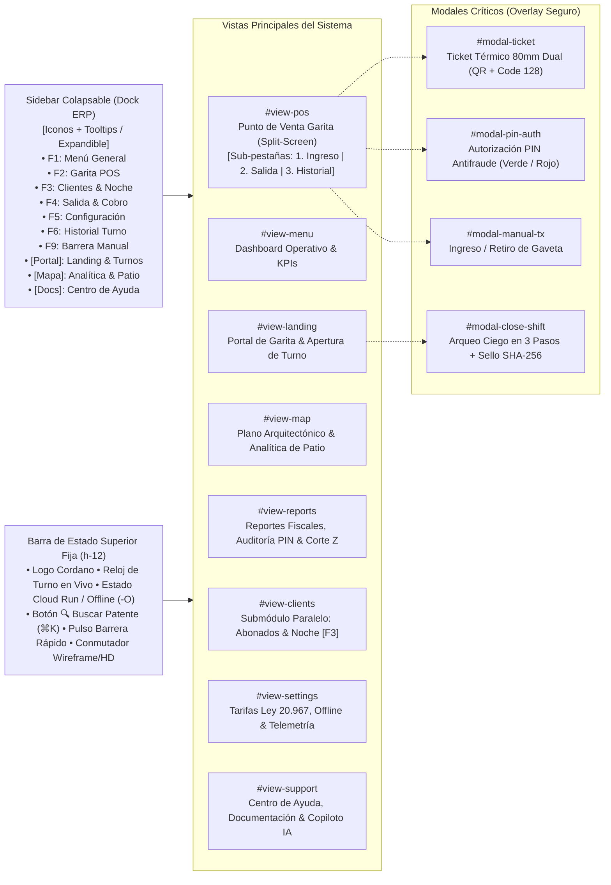

# Especificación de UX Flow y Arquitectura de Información: ParkOps PMS & ERP

**Proyecto**: ParkOps PMS & ERP Enterprise v4.5  
**Ubicación**: Calle Serrano 447, Iquique, Chile (~700 m², 30 Plazas)  
**Fecha**: Octubre 2026 | **Estado**: Oficial y Aprobado tras Grill-Me UI  

---

## 1. Visión General y Principios de Diseño UX

La arquitectura de información y los flujos de usuario de ParkOps están diseñados para maximizar la velocidad operativa y la certeza transaccional en un entorno de garita de alta rotación vehicular. 

### Principios Rectores:
1. **Operación 100% Determinista (Sin Dependencias de IA en Garita)**:
   - Todo ingreso vehicular, cobro, liquidación y apertura de barrera se realiza por métodos directos, rápidos y predecibles (digitación en teclado físico con atajos `F1` a `F9`, lectores ópticos 2D / láser y botones de acción inmediata).
   - Las capacidades de IA quedan relegadas estrictamente a módulos de asistencia informativa y soporte (`#view-support`), sin bloquear ni ralentizar la línea de caja.
2. **Navegación Lateral Colapsable (Dock ERP)**:
   - La navegación principal se traslada a una barra lateral izquierda colapsable (64px modo compacto con tooltips / 220px modo expandido), otorgando el 100% de la altura vertical de la pantalla al flujo operativo del POS.
3. **Flujo Split-Screen en Garita (1080p Sin Scroll)**:
   - En una resolución estándar de 1920x1080, el operador visualiza simultáneamente el formulario de acción a la izquierda (Ingreso o Cobro) y la lista/matriz de vehículos en patio a la derecha, eliminando desplazamientos verticales u horizontales.
4. **Resiliencia Offline-First Transparente**:
   - El sistema opera sin fisuras ante cortes de enlace con Cloud Run. Las transacciones se almacenan localmente en `IndexedDB` con sufijo `-O` y se sincronizan automáticamente en segundo plano cuando la red se recupera.

---

## 2. Jerarquía de Navegación Global (Information Architecture)

---

## 3. Matriz de Roles de Usuario y Permisos (RBAC)

| Módulo / Acción | Operador de Garita (`OP-01`) | Supervisor / Administrador (`ADM-01`) |
| :--- | :---: | :---: |
| **Apertura de Turno con Fondo ($50.000)** | ✅ Permitido (Obligatorio) | ❌ Incompatible (Debe usar perfil Operador) |
| **Ingreso Vehicular [F2] & Emisión Ticket** | ✅ Permitido | ✅ Permitido |
| **Liquidación de Salida [F4] & Cobro CLP** | ✅ Permitido | ✅ Permitido |
| **Descuentos Comerciales** | ✅ Con PIN Operador (`1234`) + Justificación | ✅ Permitido |
| **Cobro Ticket Extraviado ($8.000)** | ❌ Requiere PIN Admin | ✅ Con PIN Admin (`9999`) + Padrón |
| **Anulación de Ticket Emitido** | ❌ Requiere PIN Admin | ✅ Con PIN Admin (`9999`) |
| **Submódulo Paralelo (Abonados/Noche)** | ✅ Registro básico de plaza | ✅ Configuración y cobro mensual |
| **Cierre de Turno (Arqueo Ciego SHA-256)** | ✅ Declaración física obligatoria | ✅ Supervisión y firma de Corte Z |
| **Configuración de Tarifas Ley 20.967** | ❌ Solo lectura | ✅ Edición autorizada |

---

## 4. Flujo Detallado de Pantallas (Screen-by-Screen Flows)

### 4.1 Flujo 1: Apertura de Turno e Inicio de Jornada (`#view-landing` $\to$ `#view-menu`)
1. **Punto de Entrada**: Carga inicial del navegador o cierre del turno anterior.
2. **Interacción**:
   - El operador selecciona el rol `Operador de Garita` (deshabilita perfil de Administrador para abrir caja).
   - Digita su usuario, contraseña y declara el fondo de sencillo obligatorio de **`$50.000 CLP`**.
   - Presiona `Enter` o hace clic en **`Iniciar Turno de Caja`**.
3. **Paso Intermedio (Checklist)**:
   - Se presenta el Menú Principal (`#view-menu`) con el **Checklist de Calidad de Apertura** (6 ítems de seguridad: cámaras, alumbrado, extintor, limpieza, concordancia de plazas y papel térmico 80mm).
   - El operador marca los ítems y pulsa **`Firmar Apertura de Garita`**.
4. **Punto de Salida**: Redirección automática inmediata al **Punto de Venta POS** (`#view-pos` / `[F2]`) con autofoco en el campo de patente.

---

### 4.2 Flujo 2: Ingreso Vehicular Ultra-Rápido (`#view-pos` $\to$ Subpestaña 1)
- **Tiempo Objetivo**: Menos de 4 segundos.
- **Sin Inteligencia Artificial Obligatoria**: Ingreso directo manual o por escaneo óptico sin retrasos de red ni llamadas a modelos generativos.
- **Paso a Paso**:
  1. El operador pulsa **`F2`** (el cursor se sitúa de inmediato en `#pos-entry-plate`).
  2. Digita la patente chilena o extranjera (ej. `BCDF10`).
  3. Si la patente ya se encuentra en patio, se activa la alerta **Anti-Passback** con opción directa de transferir el vehículo a la pantalla de cobro.
  4. Selecciona la categoría vehicular con un solo toque (Sedán `$25`, SUV `$30`, Moto `$15`).
  5. Presiona **`Enter`**:
     - Se invoca `POST /api/checkin` (o se encola localmente en modo offline `-O`).
     - Se levanta la barrera (pulso a relé en puerto local o simulado en `F9`).
     - Se abre la ventana `#modal-ticket` mostrando el ticket térmico de 80mm con código dual QR / Code 128 y la leyenda legal del recargo de `$8.000 CLP`.
     - Se presiona `Enter` para imprimir y cerrar el modal. La plaza cambia a Gris Pizarra (`#64748B`) en la lista lateral.

---

### 4.3 Flujo 3: Liquidación de Salida y Cobro (`#view-pos` $\to$ Subpestaña 2)
- **Paso a Paso**:
  1. El cliente presenta el ticket térmico en ventanilla.
  2. El operador pulsa **`F4`** (autofoco en el buscador de tickets) y escanea con pistola láser o selecciona el auto directamente en la lista lateral de patio.
  3. El sistema calcula la tarifa exacta bajo la **Ley N° 20.967**:
     - **0 minutos de gracia** (todo minuto de permanencia se tarifica).
     - Base inicial de 30 minutos según categoría.
     - Cómputo del total a pagar en tipografía monoespaciada tabular (`tabular-nums font-mono`).
  4. El operador selecciona el medio de pago:
     - **Efectivo**: Digita el monto entregado por el cliente; el sistema calcula el vuelto exacto y emite pulso para abrir la gaveta RJ11.
     - **Tarjeta Transbank POS**: Ingresa el código de aprobación.
     - **Transferencia**: Verifica abono bancario.
  5. Casos Especiales (Branching):
     - **Descuento Comercial**: Hace clic en *Aplicar Descuento* $\to$ abre `#modal-pin-auth` en contexto **Verde** $\to$ ingresa PIN de Operador (`1234`) y justificación $\ge 10$ caracteres.
     - **Ticket Extraviado**: Hace clic en *Ticket Perdido* $\to$ abre `#modal-pin-auth` en contexto **Rojo** $\to$ ingresa PIN de Administrador (`9999`) y se aplica el recargo legal de **`$8.000 CLP`**.
  6. Presiona **`Confirmar Cobro y Salida`**:
     - Se registra en `POST /api/checkout`.
     - La plaza física se libera en la matriz (vuelve a Verde Esmeralda `#10B981`).
     - Se emite pulso de apertura de barrera de salida.

---

### 4.4 Flujo 4: Submódulo en Paralelo — Abonados y Noche (`#view-clients` / `[F3]`)
- **Regla de Dominio #7**:
  - Vehículos que pernoctan en garita (`$8.000 CLP`) o clientes corporativos mensuales (`$75.000 CLP/mes`).
  - Bloquean una plaza física demarcada en la matriz (ej. `B-29`, `B-30`) para evitar sobreventa.
  - **No entran a la nómina de transitorios ni alteran la caja rotativa diaria por minuto**.

---

### 4.5 Flujo 5: Cierre de Turno y Arqueo Ciego (`#modal-close-shift` / `[F9]`)
1. El operador pulsa **`Cerrar Turno`** en la cabecera o mediante el atajo `F9`.
2. **Paso 1 (Conteo Físico Ciego)**:
   - El operador digita el efectivo físico que tiene en su gaveta sin ver el saldo acumulado en sistema.
3. **Paso 2 (Conciliación Determinista & Criptográfica)**:
   - El sistema revela:
     - Efectivo registrado por sistema (fondo inicial + cobros en efectivo - retiros).
     - Efectivo físico declarado por el operador.
     - Diferencia neta (`$0` = Cuadre Perfecto; saldo positivo = Sobrante; saldo negativo = Faltante).
   - Se genera el sello criptográfico inmutable con algoritmo **`SHA-256`**.
4. **Paso 3 (Emisión de Corte Z Fiscal)**:
   - Se imprime el comprobante de cierre de turno y se resetea la garita para el siguiente turno, cerrando la sesión de caja de manera irreversible.

---

## 5. Estados de Interfaz (Empty, Loading, Error y Offline)

| Estado | Comportamiento Visual en UI | Acción de Recuperación |
| :--- | :--- | :--- |
| **Patio Vacío (0 Vehículos)** | Ilustración wireframe limpia: *"No hay vehículos activos en patio. Presione [F2] para registrar el primer ingreso."* | Autofoco inmediato en campo de patente al presionar `F2`. |
| **Patio Lleno (30/30 Plazas)** | Badge rojo `LLENO (30/30)` en cabecera y botón para habilitar plazas de sobrecupo `SC-01..05`. | El sistema impide check-in regular a menos que se asigne cupo de sobrecupo. |
| **Error de Validación de Patente** | Borde rojo en input de patente y mensaje: *"Formato de patente no válido (esperado: 4 letras y 2 números o patente Mercosur)"*. | Corrección en línea; no bloquea la UI. |
| **Corte de Enlace (Offline)** | La barra superior cambia a badge ámbar `MODO OFFLINE (CONTINGENCIA -O)`. Los tickets añaden sufijo `-O`. | Almacenamiento local en `IndexedDB`. Sincronización automática de fondo al restablecerse `/api/health`. |
| **Anti-Passback Detectado** | Cartel ámbar bajo el input de patente: *"Patente ya activa en patio en plaza X-YY"*. | Botón directo *"Ir a Cobro de Salida →"* para liquidar el vehículo preexistente. |
